<p align="center">
  
</p>

<h1 align="center">AgriAgentOS · 田掌柜</h1>

<p align="center"><strong>把日常农场经营，变成可执行、可追溯的对话。</strong></p>

<p align="center">
  简体中文 · <a href="README_en.md">English</a>
</p>

<p align="center">
  <a href="https://github.com/ArtLjn/agriagent-os/releases/tag/v2.0.0"></a>
  
  
  
  
  <a href="archive/docs/farm-manager-design-spec/LICENSE"></a>
</p>

<p align="center">
  <a href="#overview">项目概览</a> · <a href="#preview">界面图墙</a> · <a href="#features">功能详解</a> · <a href="#workflows">使用场景</a> · <a href="#architecture">系统架构</a><br>
  <a href="#quickstart">本地启动</a> · <a href="#api">接口接入</a> · <a href="#deployment">部署说明</a> · <a href="#development">开发指南</a> · <a href="#faq">常见问题</a> · <a href="#docs">文档导航</a>
</p>

<a id="overview"></a>

## 项目概览

田掌柜是面向农场日常经营的 AI 助手与管理工作台。它把作物、种植周期、农事记录、收支、天气和提醒放在同一套系统中，让使用者通过对话查询信息、整理计划，并在授权后执行操作。

仓库同时包含 **React 管理后台、Flutter App，以及通过 MCP 协作的 Business / Agent 双服务**。对经营者，它是处理日常事务的工作台；对开发者，它提供从业务工具到会话、记忆、审批和执行追踪的完整工程入口。

- **对话连接实际业务**：Agent 调用业务工具，读写真实的农场数据；需要确认的操作通过审批流程继续执行。
- **记忆由用户掌握**：称呼、表达方式和长期偏好可配置，已保存记忆可查看、修改或删除；也可以使用临时对话。
- **执行过程可以检查**：Playground 展示工具调用与执行进展，Trace 支持查看请求、节点、上下文和记忆注入，Token 页面帮助观察模型用量。

| 领域 | 当前能力 |
| --- | --- |
| 农场经营 | 仪表盘、作物模板、种植周期、农事日志、收支与用工管理 |
| 日常协作 | 提醒 / 备忘录、天气查询与预警、业务调试工作台 |
| AI 助手 | 流式对话、工具路由与调用、操作审批、历史会话与草稿 |
| 个性化与记忆 | 个性化设置、长期记忆、偏好自动学习、临时对话与记忆开关 |
| 开发与运维 | Playground、Skill 注册表、Prompt 管理、Trace、Token 用量和用户额度 |

**当前版本：v2.0.0** · [更新日志](CHANGELOG.md) · [GitHub Release](https://github.com/ArtLjn/agriagent-os/releases/tag/v2.0.0)

当前开发主线为 `agri_backend_v2/`。页面、能力和接入说明以当前实现为准，历史实现与迁移边界见文末的[当前范围与常见问题](#faq)。

<a id="preview"></a>

## 界面图墙

以下展示 10 张管理端页面和 5 张 App 页面。所有截图直接展开，点击任意图片可查看原图。管理端截图来自本次更新，App 沿用现有图片。

### 管理后台 · 经营与 Agent 工作台

<table>
  <tr>
    <td width="50%" valign="top" align="center">
      <a href="archive/docs/assets/screenshots/admin-playground.png">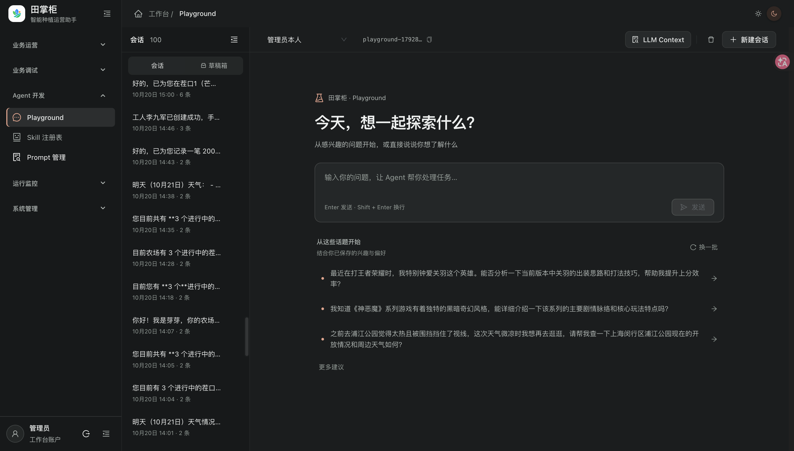</a>
      <p><strong>Agent Playground</strong><br>会话列表、问题推荐与对话入口</p>
    </td>
    <td width="50%" valign="top" align="center">
      <a href="archive/docs/assets/screenshots/admin-playground-execution.png">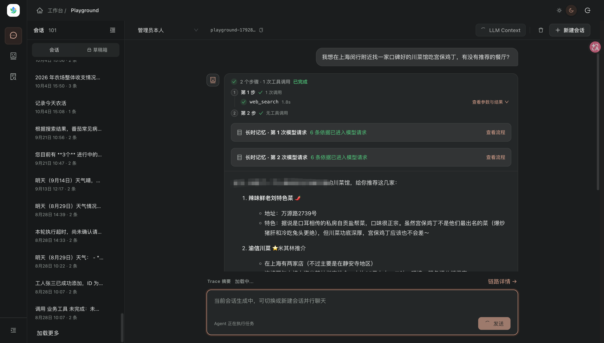</a>
      <p><strong>对话与执行过程</strong><br>查看工具调用、执行进展与回答</p>
    </td>
  </tr>
  <tr>
    <td width="50%" valign="top" align="center">
      <a href="archive/docs/assets/screenshots/admin-dashboard.png">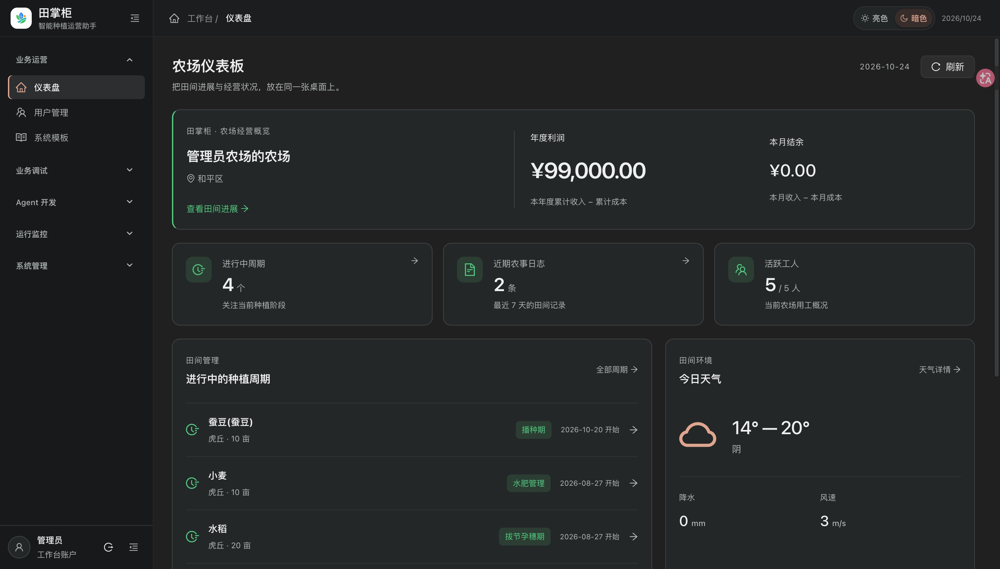</a>
      <p><strong>农场仪表盘</strong><br>集中查看经营概况与常用入口</p>
    </td>
    <td width="50%" valign="top" align="center">
      <a href="archive/docs/assets/screenshots/admin-memos.png">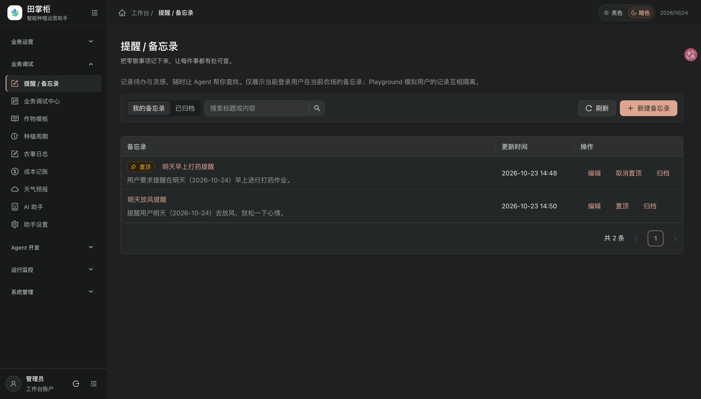</a>
      <p><strong>提醒与备忘录</strong><br>搜索、整理、置顶和归档日常事项</p>
    </td>
  </tr>
  <tr>
    <td width="50%" valign="top" align="center">
      <a href="archive/docs/assets/screenshots/admin-weather.png">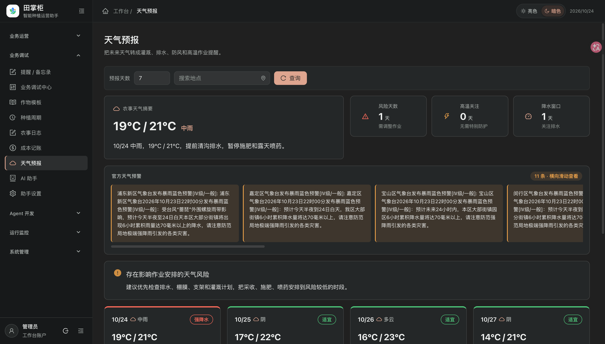</a>
      <p><strong>天气预报与预警</strong><br>结合天气信息安排农事活动</p>
    </td>
    <td width="50%" valign="top" align="center">
      <a href="archive/docs/assets/screenshots/admin-user-quotas.png">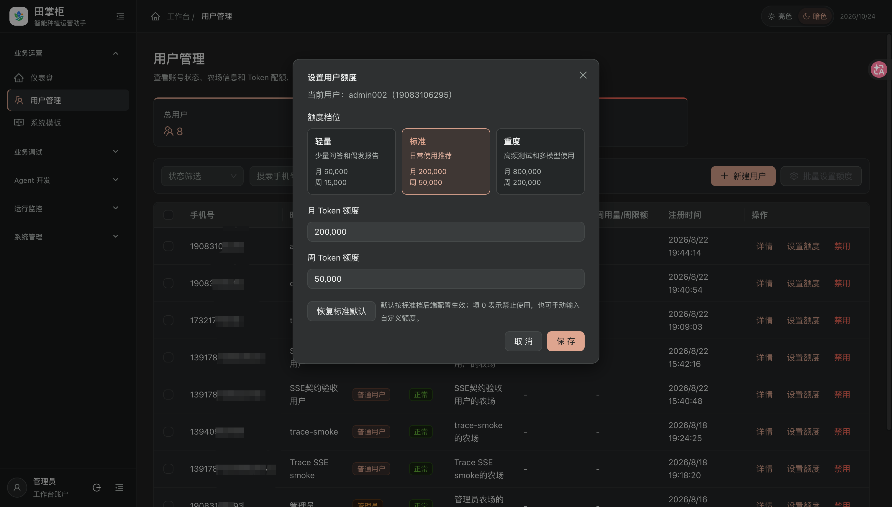</a>
      <p><strong>用户与额度管理</strong><br>管理用户账号及周、月 Token 额度</p>
    </td>
  </tr>
  <tr>
    <td width="50%" valign="top" align="center">
      <a href="archive/docs/assets/screenshots/admin-assistant-settings.png">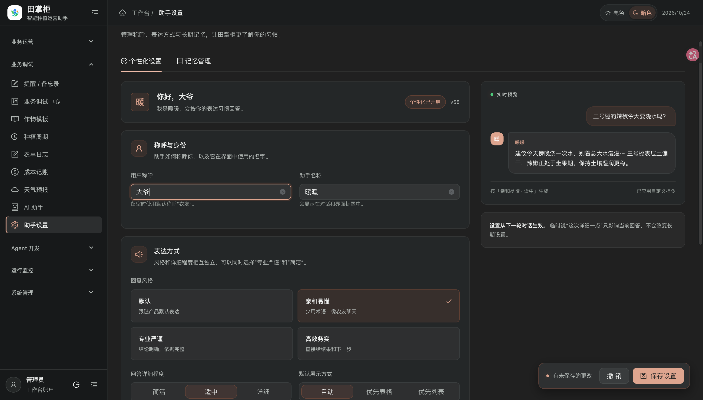</a>
      <p><strong>助手个性化设置</strong><br>调整称呼、表达方式并查看预览</p>
    </td>
    <td width="50%" valign="top" align="center">
      <a href="archive/docs/assets/screenshots/admin-memory-management.png">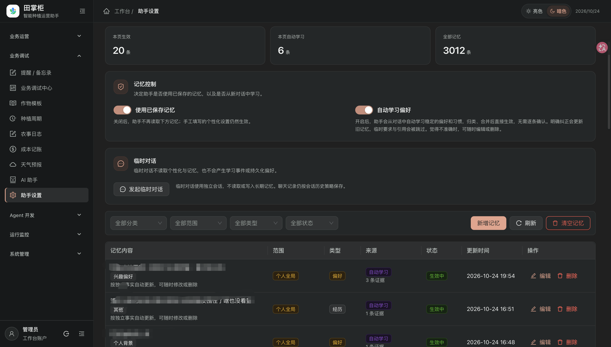</a>
      <p><strong>长期记忆管理</strong><br>查看记忆、控制学习、发起临时对话</p>
    </td>
  </tr>
  <tr>
    <td width="50%" valign="top" align="center">
      <a href="archive/docs/assets/screenshots/admin-trace-monitor.png">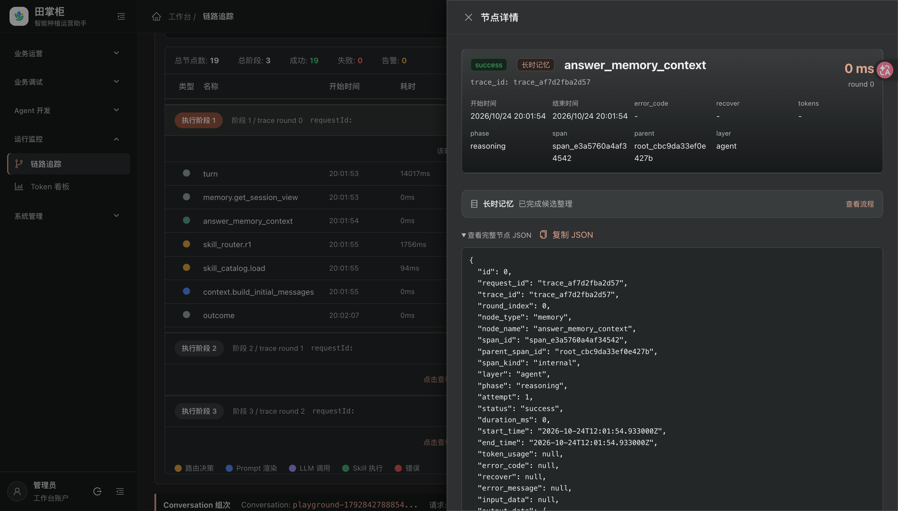</a>
      <p><strong>Trace 链路追踪</strong><br>深入节点详情，核对上下文与记忆注入</p>
    </td>
    <td width="50%" valign="top" align="center">
      <a href="archive/docs/assets/screenshots/admin-login.png">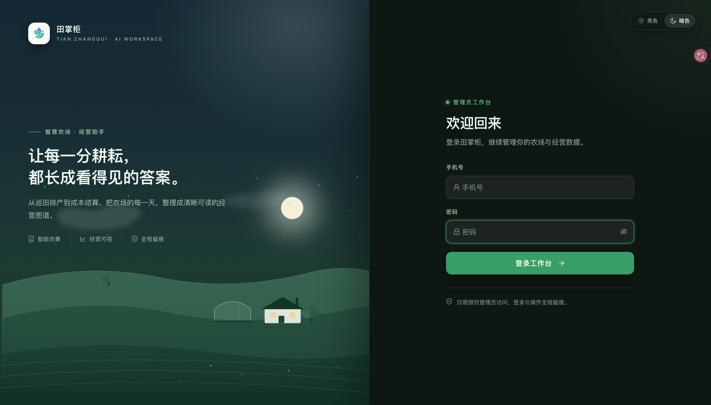</a>
      <p><strong>田掌柜登录页</strong><br>统一品牌与管理工作台入口</p>
    </td>
  </tr>
</table>

### Flutter App · 移动经营入口

手机端围绕首页、记录、AI 助手、账本与资料管理组织日常操作。以下保留已有截图，展示移动端的主要使用场景。

<table>
  <tr>
    <td width="20%" valign="top" align="center"><a href="archive/docs/assets/screenshots/mobile-home.png">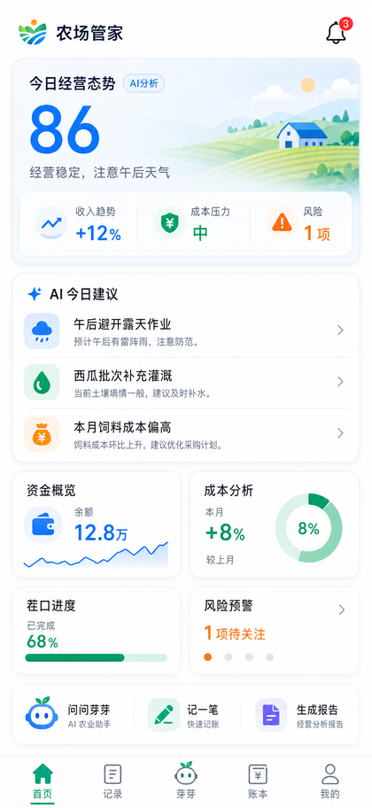</a><br><strong>首页工作台</strong></td>
    <td width="20%" valign="top" align="center"><a href="archive/docs/assets/screenshots/mobile-record.png">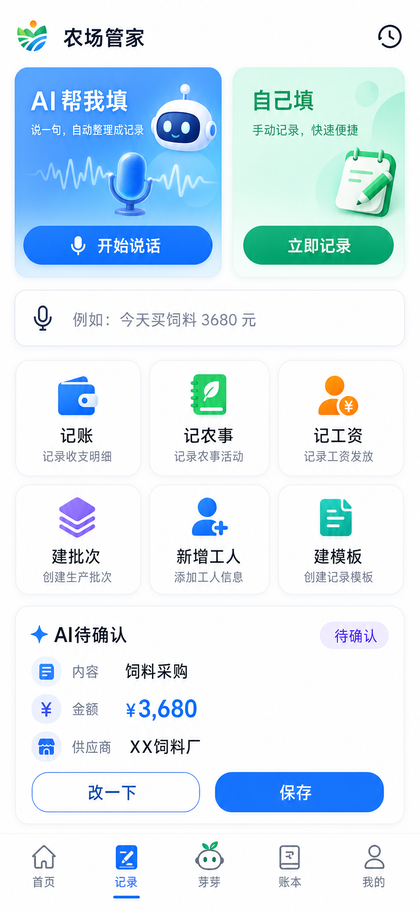</a><br><strong>记录入口</strong></td>
    <td width="20%" valign="top" align="center"><a href="archive/docs/assets/screenshots/mobile-yaya.png">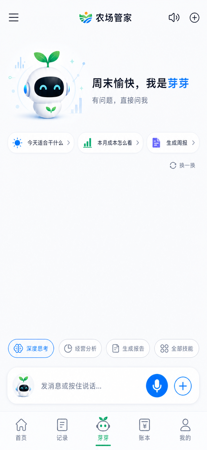</a><br><strong>AI 助手</strong></td>
    <td width="20%" valign="top" align="center"><a href="archive/docs/assets/screenshots/mobile-ledger.png">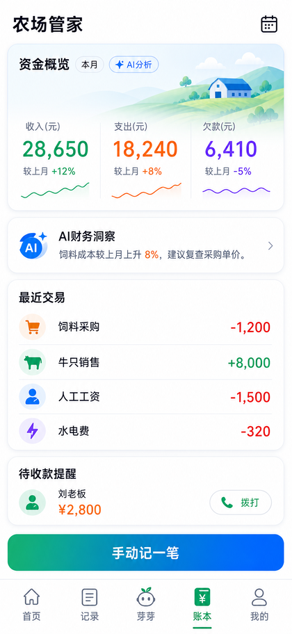</a><br><strong>收支账本</strong></td>
    <td width="20%" valign="top" align="center"><a href="archive/docs/assets/screenshots/mobile-crop-templates.png">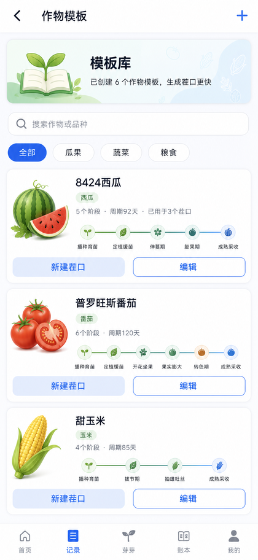</a><br><strong>作物模板</strong></td>
  </tr>
</table>

<a id="features"></a>

## 功能详解

### 农场经营：把计划、作业和账目放在一起

农场数据由 Business 服务统一管理，管理后台、App 和 Agent 工具共享业务规则。可以从页面直接维护，也可以让助手根据自然语言查询和组织操作。

| 模块 | 可以做什么 | 管理端入口 |
| --- | --- | --- |
| 仪表盘 | 查看经营概况、数据摘要和常用功能入口 | `/dashboard` |
| 作物模板 | 维护作物与生长阶段，查看系统模板并导入农场使用 | `/crops`、`/crops/system` |
| 种植周期 | 创建茬口、关联作物模板、查看周期详情与推进阶段 | `/cycles` |
| 农事日志 | 按日期与作业类型记录农事，查询已经发生的活动 | `/logs` |
| 收支与账本 | 管理收入、支出及分类，查看账务记录与经营摘要 | `/costs` |
| 地块与作业 | 在业务调试中心维护种植单元、作业单等业务数据 | `/operations` |
| 工人与工资 | 管理工人、用工记录与应付 / 已付工资，查询未结款情况 | `/operations` |
| 天气与预警 | 查看天气预报、实时天气与预警，辅助安排作业 | `/weather` |
| 提醒 / 备忘录 | 新建、搜索、编辑、置顶、归档与恢复日常事项 | `/memos` |

“备忘录”“农事日志”和“长期记忆”有不同用途：备忘录记录要办或要记的事；农事日志记录实际作业；长期记忆保存稳定的个人偏好与使用习惯。备忘录当前不包含定时通知或重复提醒调度。

### Agent 助手：从理解请求到执行工具

Agent 根据本轮问题、会话上下文与可用工具组织执行。简单聊天可以直接回答；涉及业务数据时，通过已注册 Skill 调用 Business MCP 工具，而不是让模型自行拼接数据库操作。

- **流式反馈**：通过 SSE 展示回答与执行状态，用户可以观察任务进展。
- **工具路由**：按请求选择候选工具，工具定义包含用途、参数约束和风险等级。
- **操作确认**：需要确认的写操作进入审批流程，确认后才继续执行对应动作。
- **结果回传**：业务服务返回成功结果或结构化错误，Agent 据此组织回复，Trace 保留执行证据。
- **过程追踪**：请求、会话与 Turn 共同定位一次交互，便于排查工具错误、等待审批或上下文问题。

### Playground：对话与调试共用一个工作区

Playground 面向实际交互和开发调试，集中呈现会话列表、消息、执行过程与输入区。

| 功能 | 使用方式 |
| --- | --- |
| 会话管理 | 创建新会话、切换历史记录、分页浏览会话列表 |
| 草稿箱 | 将已持久化、未在生成中的会话归档，恢复后继续对话 |
| 会话删除 | 在草稿箱中确认删除；删除会话不会自动删除已保存的长期记忆 |
| 猜你想问 | 根据已保存偏好和实际只读能力生成快捷问题，支持换一批与失败重试 |
| 推荐点击 | 只填入输入框并聚焦，用户可修改后再发送 |
| 执行面板 | 查看工具调用、进展和记忆上下文，关联请求链路定位问题 |
| Context 检查 | 通过 LLM Context 与 Trace 查看模型请求使用的上下文 |

### 个性化与记忆：让助手理解长期习惯

个性化设置负责用户主动指定的称呼与表达方式；长期记忆负责跨会话保存和检索稳定信息。二者可以独立理解和管理。

| 控制项 | 作用 |
| --- | --- |
| 个性化设置 | 配置称呼、助手表达方式与回答偏好，并通过预览了解效果 |
| 使用已保存记忆 | 决定回答是否读取长期记忆；关闭后，手工个性化设置仍可生效 |
| 自动学习偏好 | 从普通对话中抽取稳定事实，在后台归并与更新；可以随时关闭 |
| 记忆管理 | 按分类、范围、类型和状态浏览，查看来源，新增、编辑、删除或清空记忆 |
| 临时对话 | 不读取个性化与长期记忆，也不创建长期学习事件；聊天历史仍按既有策略保存 |

后台学习区分稳定偏好与一次性安排，保留事实来源、作用范围与条件。用户纠正信息时更新对应事实，删除或关闭学习后，旧任务不能重新发布已撤回的记忆。自动学习可能晚于当前回答完成，其状态可从界面与 Trace 中核对。

记忆读取以 MongoDB 中的有效正文为准，可接入 **[QuillRAG](https://github.com/ArtLjn/QuillRAG)** 提供语义召回。词项与语义结果融合后还要核对用户、农场、版本和删除状态，避免把过期或越权索引直接用于回答。

### 运行监控：回答之外也能看到证据

- **Trace 链路追踪**：查看请求列表、执行节点、事件与时间线，定位模型调用、工具执行和记忆检索问题。
- **记忆上下文详情**：核对召回结果、实际注入内容与耗时，区分“检索命中”和“最终回答采用”。
- **Token 用量**：按日期、小时、用户和模型查看统计，来源是已持久化的模型调用 Trace。
- **用户与额度**：维护用户账号及周、月 Token 额度，并在管理界面查看对应使用情况。

Token 看板只累计带真实 usage 的模型调用，不估算缺失数据；统计受 Trace 写入延迟与保留期影响，用于运行分析，不能替代模型供应商账单。

### Skill 与 Prompt：扩展能力有明确入口

Skill 定义位于 `agent/tools/`，描述工具能力、调用参数、适用场景和风险等级。声明式 MCP Skill 可以直接封装 Business 工具，需要额外编排时再增加执行脚本。Skill 注册表用于检查运行时加载情况。

Prompt 模板位于 `agent/prompts/`，由版本控制维护。管理端支持搜索、全文预览、内容指纹查看与重新加载；模板修改仍在代码仓库中进行。重载影响当前进程后续创建的上下文，多实例发布需要同步更新所有实例。

<a id="workflows"></a>

## 使用场景与首次体验

### 可以怎样和田掌柜交流

以下是请求示例，具体执行取决于账号权限、当前农场数据和已配置服务；需要确认的动作会先展示审批。

| 场景 | 示例请求 | 对应能力 |
| --- | --- | --- |
| 查看近期农事 | “总结最近一周做了什么。” | 聚合已有农事日志，整理记录与分类数量 |
| 盘点待结款 | “还有哪些钱没结？” | 分别查询应收、应付赊账和未付工资 |
| 保存采购事项 | “帮我记一下，下次买 20 个滴灌接头。” | 创建备忘录，后续可检索、置顶或归档 |
| 查找已有笔记 | “找一下我之前记的采购清单。” | 搜索当前用户在当前农场保存的备忘录 |
| 了解天气 | “帮我看看农场所在地这几天的天气。” | 查询天气信息，基于返回结果辅助规划 |
| 调整表达方式 | “回答时先给结论，再列出操作步骤。” | 通过个性化设置或稳定偏好调整回答方式 |
| 跨会话延续偏好 | “我更喜欢简短的回答。” | 开启学习时在后台整理稳定偏好，之后可在记忆页核对 |
| 开发排查 | “这次回答为什么没有用到刚保存的记忆？” | 在 Trace 与 Context 中检查检索、注入和最终请求 |

### 从空环境到一条可追溯记录

1. **完成启动与登录**：按下方步骤准备数据库、模型和双服务，登录管理后台。
2. **熟悉经营入口**：查看仪表盘、作物模板与业务调试中心；空库没有经营记录时会显示空状态。
3. **发起一次只读对话**：在 Playground 查询天气或已有记录，确认模型服务与业务工具能够连接。
4. **保存一条备忘录**：发送采购事项，核对审批内容后确认，在备忘录页面查看实际保存结果。
5. **设置助手偏好**：调整称呼与表达方式；如启用自动学习，可在记忆管理中检查新事实及来源。
6. **回看执行链路**：打开 Trace，按请求定位工具结果和记忆上下文，确认界面反馈与实际执行一致。

<a id="architecture"></a>

## 系统架构

Business 负责业务规则、权限和关系数据，同时提供 REST API 与 MCP 工具；Agent 负责对话编排、工具执行、上下文和记忆。两个服务独立运行，前端分别连接业务 API 与 Agent 流式接口。

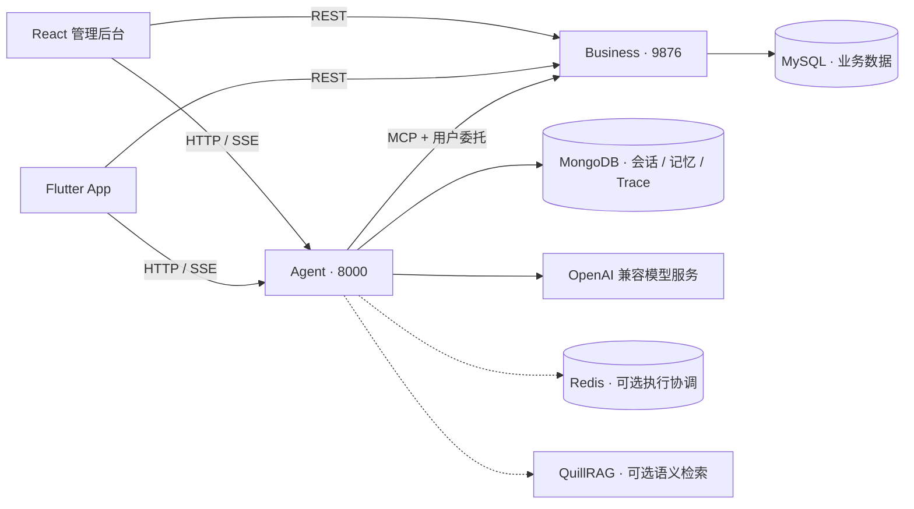

| 模块 | 技术与职责 |
| --- | --- |
| Business | Python 3.11+、FastAPI、FastMCP、SQLAlchemy、MySQL；REST 与 MCP 共用业务服务 |
| Agent | FastAPI、OpenAI SDK、MCP Client、SSE；运行时、路由、审批、上下文、记忆与可观测性 |
| 管理后台 | React 19、TypeScript、Vite、Ant Design；经营管理与 Agent 调试 |
| 移动端 | Flutter、Riverpod、Dio、GoRouter；移动经营工作台与助手 |
| 存储与协作 | MySQL 保存业务数据，MongoDB 保存会话、记忆与 Trace；Redis、[QuillRAG](https://github.com/ArtLjn/QuillRAG) 按需接入 |

### 一次请求如何完成

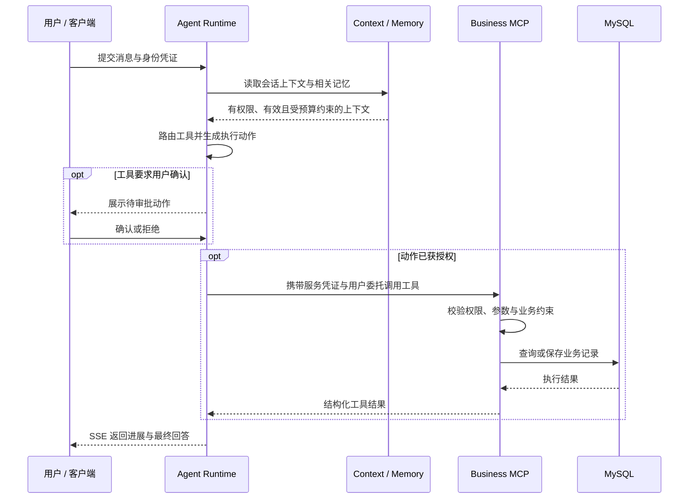

业务权限在服务端校验。模型产生的参数不能替代可信用户身份，也不能自行授予跨农场访问或跳过审批。业务记录写入由 Business 负责，Agent 保留工具调用和回答所需的上下文。

### 上下文、会话与长期记忆的分工

| 层次 | 保存 / 提供什么 | 生命周期 |
| --- | --- | --- |
| 当前消息 | 本轮用户请求与明确约束 | 当前轮次的直接输入 |
| 会话上下文 | 近期消息、摘要、当前任务与待确认动作 | 在同一会话中延续，受上下文预算约束 |
| 个性化设置 | 用户主动选择的称呼与表达方式 | 用户编辑后持续生效 |
| 长期记忆 | 有来源、范围和条件的稳定事实 | 跨会话检索，支持纠正、删除与开关控制 |
| 检索索引 | 为相关记忆提供召回候选 | 派生数据，可重建，使用前回查正文与版本 |
| Trace | 请求、节点、事件、工具结果与上下文证据 | 按追踪与保留策略保存，供排障和统计 |

MongoDB 保存会话状态、长期记忆与 Trace；MySQL 保存经营实体与业务记录。Redis 在启用时承担跨进程执行协调、队列和事件恢复等职责，不能代替上述持久数据。

### 配套项目：[QuillRAG](https://github.com/ArtLjn/QuillRAG)

[QuillRAG](https://github.com/ArtLjn/QuillRAG) 是同一作者维护的独立 RAG 服务，提供文档解析、分块、混合检索和可选重排。它单独部署，田掌柜通过 HTTP 接入其语义检索能力。

在本项目中，**MongoDB 是记忆正文的权威来源，QuillRAG 提供可重建的语义索引**。召回后仍由 Agent 核对权限与版本，再把相关内容交给主模型。语义服务不可用时，读取链路可以降级为词项召回，Trace 会记录实际检索状态。

| 配置 | 位置 / 环境变量 | 用途 |
| --- | --- | --- |
| 服务地址 | `memory.rag_url` / `MEMORY_RAG_URL` | Agent 可访问的 QuillRAG 地址 |
| 调用凭证 | `memory.rag_api_key` / `MEMORY_RAG_API_KEY` | 服务端调用认证 |
| 索引集合 | `memory.rag_collection` / `MEMORY_RAG_COLLECTION` | 区分记忆索引与环境 |
| 读取模式 | `memory.context_mode` / `MEMORY_CONTEXT_MODE` | 当前默认使用 `retrieve` 检索模式 |

先按 [QuillRAG 项目说明](https://github.com/ArtLjn/QuillRAG#readme) 配置模型与索引服务，再填写 Agent 配置并重启。索引与查询需要使用一致的嵌入模型和维度；更换模型时应使用新集合重建索引。`memory_semantic_configured` 只表示配置存在，真实接通与召回结果要结合 Trace 核验。

### 代码目录

```text
agri_backend_v2/
├── businesses/
│   └── farm/                  # 农场业务项目：skills、prompts、SQL 与 farm_business 服务
├── shared/                    # 跨业务共享包（角色、API 响应、地区数据）
├── agent/
│   ├── bootstrap/             # 应用入口与生命周期
│   ├── domains/harness/       # 运行时、上下文、记忆、路由、审批与追踪
│   ├── platforms/             # 模型、MCP 与持久化适配
│   ├── tools/                 # 核心通用能力：算术、联网搜索
│   └── prompts/               # 平台提示词模板
├── tests/                     # Agent 与跨边界测试
└── docs/                      # 当前架构、协议与功能设计
agri_admin_web/                 # React 管理后台
agri_mobile_app/                # Flutter App
agri_home_index/                # 产品介绍站点
deploy/                        # 部署与本地联调脚本
scripts/                       # 架构、复杂度与文档检查
archive/                       # 历史实现、设计资料与 README 截图
```

<a id="quickstart"></a>

## 本地启动

### 1. 准备环境

需要 Git、Python 3.11+、[uv](https://docs.astral.sh/uv/)、Node.js（满足 Vite 8 / pnpm 11 的版本要求）、pnpm 11.5.3、MySQL 和 MongoDB。开发 App 时另需 Flutter SDK。Redis 与 QuillRAG 按需配置，基础启动不要求启用。

```bash
git clone https://github.com/ArtLjn/agriagent-os.git
cd agriagent-os
```

### 2. 安装后端依赖并配置

```bash
cd agri_backend_v2
uv sync --all-packages
cp -n businesses/farm/farm_business/config.example.yaml businesses/farm/farm_business/config.yaml
cp -n agent/config.example.yaml agent/config.yaml
```

按两个配置模板填写本地环境：

| 配置 | 填写位置与要求 |
| --- | --- |
| MySQL | `businesses/farm/farm_business/config.yaml` → `database.url`，指向开发数据库 |
| MongoDB | `agent/config.yaml` → `mongodb.uri`、`mongodb.database`，保存会话、记忆和 Trace |
| 模型服务 | `agent/config.yaml` → `ai.base_url`、`ai.api_key`、`ai.model`，使用支持工具调用的 OpenAI 兼容服务 |
| 用户鉴权 | 两份配置的 `auth.jwt_secret` 使用同一高强度随机密钥；保持 issuer / audience 与模板约定一致 |
| 服务调用 | 两份配置的 `auth.agent_service_token`、`auth.delegation_secret` 分别设置为一致的高强度随机值 |
| 天气与检索 | 按需填写 Business 的 `secrets` 和 Agent 的 `memory` 配置 |

部署时可使用 `JWT_SECRET`、`AGENT_SERVICE_TOKEN`、`AGENT_DELEGATION_SECRET` 覆盖 YAML；两个服务都需要收到对应值。真实密钥只保存在未跟踪的本地配置或部署环境中。

在 MySQL 中创建一个空的开发数据库，再导入 [数据库基线](agri_backend_v2/businesses/farm/sql/farm_manager.sql)。下面的命令在 `agri_backend_v2/` 中执行，替换连接参数后使用；现有数据库应通过增量迁移升级。

```bash
mysql -h <host> -u <user> -p <database> < businesses/farm/sql/farm_manager.sql
```

首次创建管理员时，在 `businesses/farm/farm_business/config.yaml` 的 `auth` 下补充 `admin_phone` 和 `admin_password`，使用尚未注册的账号。Business 启动时会创建管理员及默认农场；留空会跳过初始化，已有同手机号用户不会被自动提升权限。

### 3. 启动双服务

分别打开两个终端，均进入 `agri_backend_v2/` 后运行：

```bash
PYTHONDONTWRITEBYTECODE=1 uv run --package farm-manager-business python -m farm_business.server
```

```bash
PYTHONDONTWRITEBYTECODE=1 uv run --package farm-manager-agent python -m agent.bootstrap.app
```

### 4. 启动管理后台

在仓库根目录打开新终端：

```bash
cd agri_admin_web
pnpm install
pnpm dev
```

访问 [管理后台](http://localhost:5173)，使用上一步创建的管理员账号登录。Vite 已将 `/api` 转发至 Business，将 `/api/agent` 转发至 Agent，并改写为各自的 `/api/v2` 路径。

| 本地入口 | 地址 |
| --- | --- |
| React 管理后台 | `http://localhost:5173` |
| Business REST | `http://127.0.0.1:9876/api/v2` |
| Business MCP | `http://127.0.0.1:9876/mcp` |
| Agent API / SSE | `http://127.0.0.1:8000/api/v2` |
| Agent 独立调试页 | `http://127.0.0.1:8000` |

根目录的 `docker-compose.yaml` 属于旧后端部署配置；当前 v2 请使用上述双服务入口。

### 5. 启动 Flutter App（可选）

在仓库根目录打开新终端：

```bash
cd agri_mobile_app
flutter pub get
flutter run
```

Android 默认连接模拟器宿主地址 `10.0.2.2`，其他平台默认使用 `127.0.0.1`。真机或远程环境可通过 `--dart-define=BUSINESS_API_BASE_URL=...` 和 `--dart-define=AGENT_API_BASE_URL=...` 指定包含 `/api/v2` 的完整地址。更多联调说明见 [移动端 README](agri_mobile_app/README.md) 与 [Android 启动脚本](deploy/flutter-android.sh)。

### 6. 检查服务是否就绪

在新终端中执行以下只读请求：

```bash
curl -fsS http://127.0.0.1:9876/api/v2/health
curl -fsS http://127.0.0.1:9876/api/v2/readiness
curl -fsS http://127.0.0.1:8000/api/v2/health
```

Business 的 `health` 确认进程可响应，`readiness` 进一步检查 MySQL 连通性。Agent 健康响应包含 MongoDB、Redis 和运行配置状态；即使 HTTP 返回成功，也需要检查响应中的 `status` 与依赖状态。模型调用、工具链路和语义召回还需要通过一次实际请求验证。

<a id="api"></a>

## 接口与客户端接入

业务 API 与 Agent API 都使用 `/api/v2` 前缀，但监听不同端口。管理端通过 Vite 代理区分两者，移动端则分别配置两个基础地址。

| 接口归属 | 管理端开发代理 | 后端地址 |
| --- | --- | --- |
| Business | `/api/...` | `http://127.0.0.1:9876/api/v2/...` |
| Agent | `/api/agent/...` | `http://127.0.0.1:8000/api/v2/...` |
| Business MCP | Agent 服务直接访问 | `http://127.0.0.1:9876/mcp` |

下面列出常用入口，路径均相对于对应服务的 `/api/v2`：

| 服务 | 方法与路径 | 用途 |
| --- | --- | --- |
| Business | `POST /auth/login`、`POST /auth/register` | 登录与账号注册 |
| Business | `GET /crop-templates`、`GET /crop-cycles` | 查询作物模板与种植周期 |
| Business | `GET /farm-logs`、`POST /farm-logs` | 查询与新增农事记录 |
| Business | `GET /cost-records`、`POST /cost-records` | 查询与新增收支记录 |
| Business | `GET /workers`、`GET /weather` | 工人信息与天气 |
| Business | `GET /memos`、`POST /memos`、`PATCH /memos/{memo_id}` | 备忘录查询、创建与更新 |
| Agent | `POST /chat` | 发起对话并接收流式执行结果 |
| Agent | `POST /approve` | 提交待审批动作的用户决定 |
| Agent | `GET /turns/{turn_id}`、`GET /turns/{turn_id}/events` | 查看执行状态与事件 |
| Agent | `GET /conversations`、`PATCH /conversations/{conversation_id}` | 会话列表与归档 / 恢复 |
| Agent | `GET /me/personalization`、`PATCH /me/personalization` | 个性化设置 |
| Agent | `GET /me/memories`、`POST /me/memories` | 查看与新增长期记忆 |
| Agent | `POST /me/question-recommendations` | 生成首页快捷问题 |
| Agent | `GET /traces`、`GET /traces/{trace_id}/nodes` | 请求链路与节点详情 |
| Agent | `GET /admin/skills`、`GET /admin/prompts` | 已加载的工具与 Prompt |
| Agent | `GET /admin/stats/tokens` | 模型调用用量统计 |

客户端对受保护接口携带 `Authorization: Bearer <token>`。用户登录态、管理权限和 Agent → Business 的服务凭证是不同边界；服务凭证只保存在后端。会话、记忆与业务数据查询遵循当前身份及农场范围。

接口字段和权限以运行服务的 `/openapi.json` 为准；[API 契约文件](agri_backend_v2/docs/reference/api-spec.yaml) 与 [SSE 事件协议](agri_backend_v2/docs/spec/2026-08-21-agent-sse-execution-event-contract-proposal.md) 提供版本化参考。接入流式客户端时应处理执行进度、审批、结束与错误状态，不能只拼接文本片段。

<a id="deployment"></a>

## 部署与运行说明

### 服务拓扑与环境配置

建议分别管理 Business、Agent 和管理端静态资源的发布。Business 与 Agent 可在同一主机运行，通过回环地址连接；公网入口由反向代理统一处理 HTTPS。生产页面的 API 代理需要与本地 Vite 代理保持一致，分别转发 Business 与 Agent 请求。

| 组件 | 发布内容 | 运行时需要 |
| --- | --- | --- |
| Business | `agri_backend_v2/businesses/farm/farm_business/` 及共享代码 | MySQL、业务配置、鉴权与服务凭证 |
| Agent | `agri_backend_v2/agent/` 及共享代码、Skill、Prompt | 模型服务、MongoDB、Business MCP，按需启用 Redis / QuillRAG |
| 管理后台 | `agri_admin_web/dist/` | 静态资源服务、前端路由回退与 API 反向代理 |
| Flutter App | 对应平台的构建产物 | 可访问的 Business / Agent 地址 |
| QuillRAG | [独立仓库](https://github.com/ArtLjn/QuillRAG) 中的服务 | 按该项目说明配置嵌入模型、索引与认证 |

部署配置需要与开发环境分开：使用独立数据库或测试库，启用 Redis 时设置独立 `REDIS__KEY_PREFIX`，避免不同环境的 Worker 消费同一队列。MongoDB 数据库可通过 `MONGODB__DATABASE` 指定。生产环境关闭开发身份入口，并保持两项服务凭证和 JWT 配置一致。

SSE 代理需要关闭响应缓冲并设置足够的读取超时。仓库中的 [Nginx 示例](deploy/farm-manager-agent.nginx.example) 展示 Agent 流式接口的配置；完整管理端部署还需要业务 API 和静态资源路由。

### 仓库中已有的发布脚本

这些脚本保留了维护者现有部署环境的默认主机、目录或服务名，迁移到自己的环境时先检查并调整对应配置。

| 文件 | 作用与边界 |
| --- | --- |
| [server-sync.sh](deploy/server-sync.sh) | 同步 v2 后端，备份并保留线上配置，执行对应迁移，再重启 Business / Agent |
| [admin-web-deploy.sh](deploy/admin-web-deploy.sh) | 构建并上传管理端静态资源，可配置主机、目录与 API 基础地址 |
| [server-ctl.sh](deploy/server-ctl.sh) | 控制脚本中配置的 `farm-manager` systemd 服务，并查看日志；不等于同时管理全部组件 |
| [farm-manager-agent.nginx.example](deploy/farm-manager-agent.nginx.example) | Agent 的 HTTPS、登录入口与 SSE 反向代理示例 |
| [flutter-android.sh](deploy/flutter-android.sh) | Android 模拟器或 USB 真机联调，设置双服务地址与必要的端口转发 |

首次上线使用空库基线，已有数据库使用版本化增量迁移。代码更新后重启实际运行实例；多进程环境只重载一个进程的 Prompt 并不代表其他实例已更新。发布完成后检查服务状态，再完成一次登录、业务只读请求与 Agent 流式请求，最后核对 Trace 与前端显示。

<a id="development"></a>

## 开发与检查

从 `codex/*` 或其他功能分支发起 PR。修改应落在对应服务内，业务规则集中到现有领域服务，Skill 与 Prompt 遵循已有定义；涉及接口、配置或数据模型时同步更新对应设计文档。

以下命令在仓库根目录运行，按改动范围选择检查；完整约定见 [AGENTS.md](AGENTS.md)。

```bash
(cd agri_admin_web && pnpm lint && pnpm test && pnpm build)
(cd agri_mobile_app && flutter analyze && flutter test)
bash scripts/check-layer-deps.sh
bash scripts/check-complexity-budget.sh
bash scripts/check-doc-freshness.sh
```

后端测试位于 `agri_backend_v2/tests/`，按所改模块选择回归范围；涉及真实数据库或外部服务的集成测试使用隔离的测试环境。

截图集中放在 `archive/docs/assets/screenshots/`，按 `admin-<page-or-state>.png`、`mobile-<page-or-state>.png` 命名。发布前遮挡个人信息与凭证，替换时保留语义化文件名，并同步中英文图册。

### 扩展一个业务能力

1. **先定义业务边界**：在 `businesses/farm/farm_business/services/` 中实现权限范围内的业务规则，复用已有模型与事务边界。
2. **暴露调用入口**：按需要增加 REST 路由与 `businesses/farm/farm_business/tools/` 中的 MCP 工具，两者调用相同业务服务。
3. **注册 Agent Skill**：在 `agent/tools/` 下维护 `skill.md`，写清参数、使用场景、风险等级和需要确认的操作；声明式 MCP 封装优先复用已有执行器。
4. **接入客户端**：管理端沿用 API → 组件 → 页面依赖方向；移动端通过已有数据层连接业务接口。
5. **补充回归与文档**：覆盖成功、权限、输入错误及重试场景；同步接口契约、配置或功能设计文档。
6. **核对实际链路**：在 Playground 中执行代表性请求，从 Trace 检查工具参数、权限主体与真实结果，再发起 PR。

### 按模块验证

前端、App 和仓库检查可使用上面的命令。后端可在 `agri_backend_v2/` 中运行 Ruff，并选择所改功能对应的 pytest 文件，例如备忘录模块：

```bash
cd agri_backend_v2
uvx ruff check business agent shared
uvx ruff format --check business agent shared
PYTHONDONTWRITEBYTECODE=1 uv run --all-packages --with pytest --with pytest-asyncio python -B -m pytest tests/test_memos.py
```

确定性单元测试用于验证状态、权限与数据规则；真实模型、数据库与 SSE 联调需要单独的隔离环境。模型能返回文本、应用能构建、业务数据成功写入，是不同层次的验证结果，应分别记录。

<a id="faq"></a>

## 当前范围与常见问题

### 当前实现与历史资料

| 内容 | 当前状态 |
| --- | --- |
| Business / Agent 双服务 | 当前后端主线，代码位于 `agri_backend_v2/` |
| React 管理后台 | 经营页面、Playground、记忆管理与开发监控使用当前 v2 接口 |
| Flutter App | 保留移动业务入口；本次 README 更新沿用现有 App 截图 |
| 提醒 / 备忘录 | 支持保存和管理事项，不包含定时通知或重复调度 |
| 数据飞轮与仿真 | 历史设计保留在归档；旧页面路由转向 Trace / Playground |
| 旧版日报、建议与独立智填 | 不作为当前 v2 可用接口；移动端智能整理通过助手对话承接 |
| Docker Compose | 仓库根目录文件属于旧后端，当前 v2 使用双服务启动方式 |
| QuillRAG | 独立部署的配套项目，当前在田掌柜中接入记忆语义检索；完整文档处理能力见其仓库 |

### 排查入口

| 现象 | 优先检查 |
| --- | --- |
| 登录后跳回登录页或接口 401 | 登录态是否过期，两份配置的 JWT secret、issuer / audience 是否一致，以及代理是否连到预期服务 |
| 业务页面请求失败 | Business `readiness`、MySQL 地址与权限、目标表及增量迁移状态 |
| 对话能建立，但模型不返回结果 | 模型的 `base_url`、API Key、模型名和工具调用支持情况；结合 Agent 日志与 Trace 查看失败位置 |
| Agent 无法调用业务工具 | Business MCP 地址、服务凭证、委托密钥与当前用户权限 |
| SSE 内容直到结束才一次出现 | 反向代理是否启用了缓冲，网络层是否保留流式响应 |
| 刚说过的偏好没有出现在记忆列表 | 自动学习开关、后台学习状态、抽取结果与重试情况；学习完成可能晚于回答完成 |
| 配置了 RAG 但没有语义命中 | QuillRAG 地址、凭证、集合、嵌入模型 / 维度和索引状态；查看 Trace 的真实检索结果 |
| 新环境的仪表盘和列表为空 | 是否已创建当前农场的业务数据；空状态不会自动填入示例经营记录 |
| 手机无法访问本地服务 | 模拟器宿主地址、真机端口转发或可访问的 HTTPS 地址，以及双服务编译参数 |
| 更新 Prompt 后行为仍旧 | 模板是否已重载、请求是否到达新实例，以及多进程部署是否全部更新 |

<a id="docs"></a>

## 文档导航

| 文档 | 内容 |
| --- | --- |
| [Agent Harness 系统设计](agri_backend_v2/docs/spec/2026-08-20-agent-harness-system-design.md) | 运行时、执行边界与工程约束 |
| [Context / Session / Memory](agri_backend_v2/docs/spec/2026-08-20-agent-context-session-memory-system-design.md) | 上下文、会话与记忆分工 |
| [记忆自动学习与归并](agri_backend_v2/docs/design/self-learning-memory.md) | 长期记忆的学习、纠正与生命周期 |
| [运行架构与配置补充](agri_backend_v2/docs/architecture/overview.md) | 当前配置、记忆检索与部署核验 |
| [Skill 定义规范](agri_backend_v2/docs/spec/2026-08-07-skill-md-yaml-standard.md) | 工具定义与 YAML 元数据 |
| [API 鉴权与授权](agri_backend_v2/docs/spec/2026-08-25-api-authentication-authorization-dependency-design.md) | 用户身份、服务凭证与权限边界 |
| [SSE 事件协议](agri_backend_v2/docs/spec/2026-08-21-agent-sse-execution-event-contract-proposal.md) | 流式执行事件与前端对接 |
| [管理端与运行监控](agri_backend_v2/docs/design/admin-agent-management.md) | Prompt、Token 统计和后台导航的实现边界 |
| [会话与草稿箱](agri_backend_v2/docs/design/conversation-drafts.md) | 会话归档、恢复与删除语义 |
| [个性化问题推荐](agri_backend_v2/docs/design/personalized-question-recommendations.md) | 首页推荐的画像、生成与数据边界 |
| [备忘录与经营盘点](agri_backend_v2/docs/design/memos-and-farm-review.md) | 备忘录、农事回顾与待结款查询 |
| [Flutter App](agri_mobile_app/README.md) | 移动端运行、联调与能力边界 |
| [QuillRAG 配套项目](https://github.com/ArtLjn/QuillRAG) | 独立 RAG 服务、混合检索与部署说明 |
| [历史设计资料](archive/docs/farm-manager-design-spec/README.md) | 旧版架构与设计背景，供追溯参考 |

## 许可证

本仓库采用 [CC BY-NC 4.0](archive/docs/farm-manager-design-spec/LICENSE)。使用与分发请遵守署名及非商业使用要求；商业使用请先与维护者确认授权。
