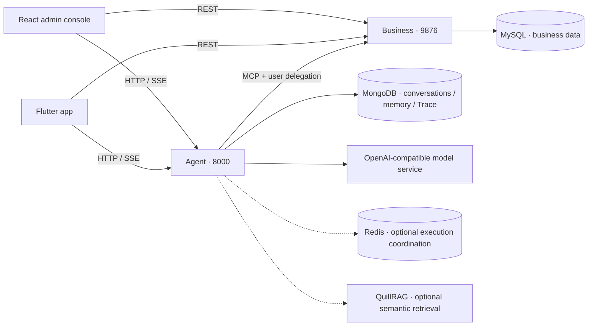
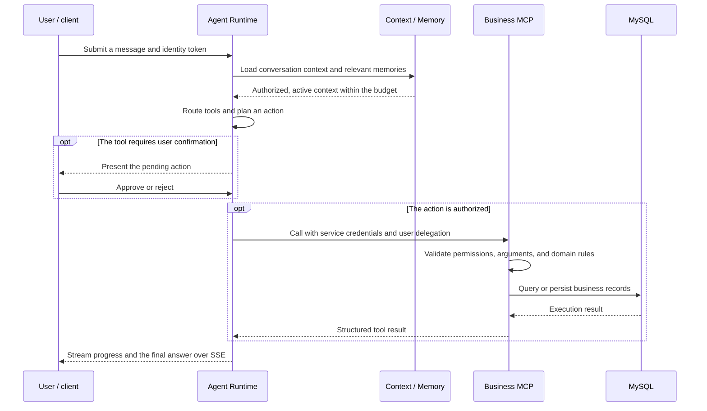

<p align="center">
  
</p>

<h1 align="center">AgriAgentOS · 田掌柜</h1>

<p align="center"><strong>Turn everyday farm operations into conversations you can act on and trace.</strong></p>

<p align="center">
  <a href="README.md">简体中文</a> · English
</p>

<p align="center">
  <a href="https://github.com/ArtLjn/agriagent-os/releases/tag/v2.0.0"></a>
  
  
  
  
  <a href="archive/docs/farm-manager-design-spec/LICENSE"></a>
</p>

<p align="center">
  <a href="#overview">Overview</a> · <a href="#preview">Screenshot gallery</a> · <a href="#features">Features</a> · <a href="#workflows">Workflows</a> · <a href="#architecture">Architecture</a><br>
  <a href="#quickstart">Local setup</a> · <a href="#api">API integration</a> · <a href="#deployment">Deployment</a> · <a href="#development">Development</a> · <a href="#faq">Troubleshooting</a> · <a href="#docs">Documentation</a>
</p>

<a id="overview"></a>

## Overview

AgriAgentOS, branded as **田掌柜 (Tian Zhang Gui)**, is an AI assistant and workspace for everyday farm operations. It brings crops, growing cycles, farm logs, income and expenses, weather, and reminders into one system. Users can ask questions, organize plans, and authorize the assistant to carry out actions against their farm data.

This monorepo includes a **React admin console, a Flutter app, and separate Business and Agent services connected through MCP**. Farm operators get a workspace for daily tasks; developers get a working implementation of business tools, conversations, memory, approvals, and execution tracing.

- **Conversations connected to real operations.** The Agent reads and writes farm data through business tools. Actions that require confirmation proceed through an approval flow.
- **Memory under user control.** Users can configure how the assistant addresses them and responds, inspect or edit saved memories, delete them, or start a temporary conversation.
- **Execution that can be inspected.** Playground shows tool calls and progress. Trace exposes requests, execution nodes, context, and injected memories; token monitoring helps track model usage.

| Area | Current capabilities |
| --- | --- |
| Farm operations | Dashboard, crop templates, growing cycles, farm logs, income and expenses, and workforce management |
| Daily planning | Reminders and memos, weather forecasts and alerts, and a business debugging workspace |
| AI assistant | Streaming conversations, tool routing and execution, action approvals, conversation history, and drafts |
| Personalization and memory | Assistant preferences, long-term memory, automatic preference learning, temporary conversations, and memory controls |
| Development and operations | Playground, Skill registry, Prompt management, Trace, token usage, and user quotas |

**Current release: v2.0.0** · [Changelog](CHANGELOG.md) · [GitHub Release](https://github.com/ArtLjn/agriagent-os/releases/tag/v2.0.0)

Active backend development takes place in `agri_backend_v2/`. This README describes the current implementation; see [current scope and troubleshooting](#faq) for legacy features and migration boundaries.

<a id="preview"></a>

## Screenshot gallery

Explore 10 admin screens and 5 app screens below. Every screenshot is displayed inline and links to its full-resolution image. The admin images reflect this update; the existing app previews are retained.

### Admin console · farm operations and Agent workspace

<table>
  <tr>
    <td width="50%" valign="top" align="center">
      <a href="archive/docs/assets/screenshots/admin-playground.png"></a>
      <p><strong>Agent Playground</strong><br>Conversations, suggested questions, and the message composer</p>
    </td>
    <td width="50%" valign="top" align="center">
      <a href="archive/docs/assets/screenshots/admin-playground-execution.png"></a>
      <p><strong>Conversation execution</strong><br>Tool calls, execution progress, and the final response</p>
    </td>
  </tr>
  <tr>
    <td width="50%" valign="top" align="center">
      <a href="archive/docs/assets/screenshots/admin-dashboard.png"></a>
      <p><strong>Farm dashboard</strong><br>Operational metrics and shortcuts to everyday tasks</p>
    </td>
    <td width="50%" valign="top" align="center">
      <a href="archive/docs/assets/screenshots/admin-memos.png"></a>
      <p><strong>Reminders and memos</strong><br>Search, organize, pin, and archive everyday notes</p>
    </td>
  </tr>
  <tr>
    <td width="50%" valign="top" align="center">
      <a href="archive/docs/assets/screenshots/admin-weather.png"></a>
      <p><strong>Weather and alerts</strong><br>Review forecasts and alerts when planning farm work</p>
    </td>
    <td width="50%" valign="top" align="center">
      <a href="archive/docs/assets/screenshots/admin-user-quotas.png"></a>
      <p><strong>Users and quotas</strong><br>Account management and weekly or monthly token limits</p>
    </td>
  </tr>
  <tr>
    <td width="50%" valign="top" align="center">
      <a href="archive/docs/assets/screenshots/admin-assistant-settings.png"></a>
      <p><strong>Assistant personalization</strong><br>Configure names and response style with a live preview</p>
    </td>
    <td width="50%" valign="top" align="center">
      <a href="archive/docs/assets/screenshots/admin-memory-management.png"></a>
      <p><strong>Long-term memory</strong><br>Inspect memories, control learning, and start temporary chats</p>
    </td>
  </tr>
  <tr>
    <td width="50%" valign="top" align="center">
      <a href="archive/docs/assets/screenshots/admin-trace-monitor.png"></a>
      <p><strong>Trace inspection</strong><br>Inspect execution nodes, context, and memory injection</p>
    </td>
    <td width="50%" valign="top" align="center">
      <a href="archive/docs/assets/screenshots/admin-login.png"></a>
      <p><strong>Sign-in</strong><br>The branded entry point to the admin workspace</p>
    </td>
  </tr>
</table>

### Flutter app · farm operations on the go

The app organizes daily work around the home workspace, records, the AI assistant, the ledger, and farm information. These existing screenshots illustrate the main mobile workflows.

<table>
  <tr>
    <td width="20%" valign="top" align="center"><a href="archive/docs/assets/screenshots/mobile-home.png"></a><br><strong>Home</strong></td>
    <td width="20%" valign="top" align="center"><a href="archive/docs/assets/screenshots/mobile-record.png"></a><br><strong>Record entry</strong></td>
    <td width="20%" valign="top" align="center"><a href="archive/docs/assets/screenshots/mobile-yaya.png"></a><br><strong>AI assistant</strong></td>
    <td width="20%" valign="top" align="center"><a href="archive/docs/assets/screenshots/mobile-ledger.png"></a><br><strong>Ledger</strong></td>
    <td width="20%" valign="top" align="center"><a href="archive/docs/assets/screenshots/mobile-crop-templates.png"></a><br><strong>Crop templates</strong></td>
  </tr>
</table>

<a id="features"></a>

## Features in detail

### Farm operations: plans, field work, and finances in one place

The Business service owns farm data and domain rules. The admin console, app, and Agent tools all use those rules. Users can maintain records through forms or ask the assistant to query data and organize an action.

| Module | What it supports | Admin route |
| --- | --- | --- |
| Dashboard | Operational summaries, metrics, and shortcuts to common tasks | `/dashboard` |
| Crop templates | Crops and growth stages, a system library, and templates imported into a farm | `/crops`, `/crops/system` |
| Growing cycles | Create crop cycles, link templates, inspect details, and advance stages | `/cycles` |
| Farm logs | Record and query completed activities by date and operation type | `/logs` |
| Income and expenses | Manage financial records and categories, with ledger summaries | `/costs` |
| Planting units and work orders | Maintain planting units, work orders, and related business data | `/operations` |
| Workers and wages | Manage workers, labor records, payable and paid wages, and outstanding amounts | `/operations` |
| Weather and alerts | Review forecasts, current conditions, and alerts when planning field work | `/weather` |
| Reminders and memos | Create, search, edit, pin, archive, and restore everyday notes | `/memos` |

Memos, farm logs, and long-term memory serve different purposes: memos capture things to do or remember; farm logs record actual work; long-term memory stores stable preferences and habits. Memos currently do not schedule timed notifications or recurring reminders.

### The Agent: from a request to a business action

The Agent combines the current request, conversation context, and available tools to organize execution. General conversation can be answered directly. Requests involving business data use registered Skills and Business MCP tools, rather than model-generated database operations.

- **Streaming feedback.** SSE carries response content and execution status so users can follow progress.
- **Tool routing.** Requests select candidate tools whose definitions describe their purpose, arguments, and risk level.
- **Action confirmation.** Write operations that require confirmation enter an approval flow before the action proceeds.
- **Grounded results.** Business services return execution results or structured errors; the assistant uses those results in its reply, while Trace retains the evidence.
- **Execution identity.** Request, conversation, and Turn identifiers help locate tool failures, pending approvals, and context issues.

### Playground: conversation and debugging in one workspace

Playground combines conversation history, messages, execution details, and the composer for both everyday interaction and development work.

| Feature | Behavior |
| --- | --- |
| Conversations | Start new chats, switch between histories, and browse paginated lists |
| Drafts | Archive persisted conversations that are not generating; restore them to continue chatting |
| Conversation deletion | Confirm deletion from drafts; deleting a conversation does not automatically remove saved long-term memories |
| Suggested questions | Generate shortcuts from saved preferences and available read-only capabilities, with refresh and retry controls |
| Selecting a suggestion | Fill and focus the composer so the user can edit before sending |
| Execution panel | Follow tool calls, progress, and memory context, then inspect the associated request trace |
| Context inspection | Use LLM Context and Trace to inspect the context supplied to model requests |

### Personalization and memory: continuity across conversations

Personalization stores explicit choices about names and response style. Long-term memory stores and retrieves stable information across conversations. They have distinct controls and purposes.

| Control | Purpose |
| --- | --- |
| Personalization settings | Configure names, tone, and response preferences, with an on-page preview |
| Use saved memories | Control whether answers read long-term memory; explicit personalization can still apply when memory reading is disabled |
| Learn preferences automatically | Extract stable facts from ordinary conversations and consolidate them in the background; learning can be disabled |
| Memory management | Browse by category, scope, type, or status; inspect sources; create, edit, delete, or clear memories |
| Temporary conversations | Skip personalization, long-term memory reads, and learning events; conversation history still follows the existing retention policy |

Background learning distinguishes stable preferences from one-off plans and preserves evidence, scope, and conditions. Corrections update the relevant facts. Deletion and learning controls prevent old tasks from republishing withdrawn memories. Learning may finish after the response stream closes; its status can be checked in the interface and Trace.

Memory reads use the active records in MongoDB as their source of truth. **[QuillRAG](https://github.com/ArtLjn/QuillRAG)** can provide semantic recall alongside lexical retrieval. Fused candidates are checked against user, farm, version, and deletion state before being used in an answer.

### Monitoring: inspect the evidence behind a response

- **Trace inspection.** Browse requests, execution nodes, events, and timelines to investigate model calls, tool execution, and memory retrieval.
- **Memory context details.** Compare retrieval results, the content actually injected, and latency; a retrieval match does not by itself show that the final answer used it.
- **Token usage.** Inspect statistics by date, hour, user, and model, based on persisted model-call traces.
- **Users and quotas.** Maintain accounts and weekly or monthly token limits, and review corresponding usage in the admin interface.

Token statistics count calls with actual usage data and do not estimate missing values. They depend on Trace retention and write latency, making them an operational view rather than a replacement for provider billing.

### Skills and Prompts: clear extension points

Skill definitions in `agent/tools/` describe capabilities, arguments, intended use, and risk levels. Declarative MCP Skills can wrap Business tools directly; execution scripts are added when additional orchestration is needed. The Skill registry exposes what the running Agent has loaded.

Prompt templates live in `agent/prompts/` and are maintained in version control. The admin interface supports search, full-text previews, content fingerprints, and reloading. Template editing happens in the repository. Reloading affects subsequent contexts in the current process; deployments with multiple instances must update every instance.

<a id="workflows"></a>

## Workflows and first steps

### Example requests

These examples depend on account permissions, available farm data, and configured services. Actions that require confirmation are presented for approval first.

| Scenario | Example request | What the system uses |
| --- | --- | --- |
| Review recent field work | “Summarize what we did over the past week.” | Existing farm logs, activity details, and category totals |
| Review outstanding payments | “Which payments are still outstanding?” | Separate views of receivables, payables, and unpaid wages |
| Save a purchasing note | “Make a note to buy 20 drip-irrigation connectors next time.” | A memo that can later be searched, pinned, or archived |
| Find an existing note | “Find the purchasing list I saved earlier.” | Memos belonging to the current user and farm |
| Check the weather | “Show me the forecast for the farm over the next few days.” | Returned weather data to support planning |
| Adjust response style | “Start with the conclusion, then list the steps.” | Explicit personalization or a stable response preference |
| Carry preferences across chats | “I prefer concise answers.” | Background preference learning, when enabled, with the result visible in memory management |
| Investigate a response | “Why did this response miss the memory I just saved?” | Trace and Context inspection of retrieval, injection, and the final request |

### From a fresh setup to a traceable record

1. **Start the services and sign in.** Configure the databases, model service, and both backend services using the steps below.
2. **Explore the business workspace.** Visit the dashboard, crop templates, and operations center. A new database shows empty states until records are added.
3. **Try a read-only conversation.** Ask about the weather or existing records in Playground to check model and business-tool connectivity.
4. **Save a memo.** Request a purchasing note, review and approve the action, then verify the saved record on the memos page.
5. **Personalize the assistant.** Adjust names and response style. If automatic learning is enabled, inspect new facts and their sources in memory management.
6. **Inspect the trace.** Locate the request, review tool results and memory context, and compare the visible response with what actually executed.

<a id="architecture"></a>

## Architecture

The Business service owns domain rules, authorization, and relational data, exposing both REST APIs and MCP tools. The Agent service handles conversation orchestration, tool execution, context, and memory. The services run independently; clients connect to the business API and Agent streaming endpoints separately.



| Component | Stack and responsibility |
| --- | --- |
| Business | Python 3.11+, FastAPI, FastMCP, SQLAlchemy, MySQL; shared business services behind REST and MCP |
| Agent | FastAPI, OpenAI SDK, MCP Client, SSE; runtime, routing, approvals, context, memory, and observability |
| Admin console | React 19, TypeScript, Vite, Ant Design; farm management and Agent debugging |
| Mobile app | Flutter, Riverpod, Dio, GoRouter; mobile operations workspace and assistant |
| Storage and coordination | MySQL for business data; MongoDB for conversations, memory, and Trace; optional Redis and [QuillRAG](https://github.com/ArtLjn/QuillRAG) |

### How a request is handled



Business permissions are enforced on the server. Model-generated arguments cannot replace trusted user identity, grant access to another farm, or bypass approval. Business owns domain writes; the Agent maintains the execution context needed for tool calls and responses.

### Context, sessions, and long-term memory

| Layer | What it contains | Lifetime |
| --- | --- | --- |
| Current message | The user's current request and explicit constraints | Direct input to the current turn |
| Conversation context | Recent messages, summaries, active tasks, and pending actions | Continues within a conversation, subject to context budgets |
| Personalization | Explicit choices about names and response style | Persists until edited by the user |
| Long-term memory | Stable facts with evidence, scope, and conditions | Retrieved across chats; supports correction, deletion, and user controls |
| Retrieval index | Candidates for relevant memories | Rebuildable derived data, checked against current records and versions |
| Trace | Requests, nodes, events, tool results, and context evidence | Retained under the tracing policy for debugging and statistics |

MongoDB stores conversation state, long-term memory, and Trace. MySQL stores business entities and operational records. When enabled, Redis coordinates execution across processes, queues, and event recovery; it does not replace those persistent stores.

### Companion project: [QuillRAG](https://github.com/ArtLjn/QuillRAG)

[QuillRAG](https://github.com/ArtLjn/QuillRAG) is an independent RAG service maintained by the same author. It provides document parsing, chunking, hybrid retrieval, and optional reranking. It is deployed separately, and AgriAgentOS connects to its semantic retrieval capabilities over HTTP.

Here, **MongoDB remains the source of truth for memory records, while QuillRAG provides a rebuildable semantic index**. After retrieval, the Agent rechecks permissions and versions before passing relevant content to the main model. If semantic retrieval is unavailable, the read path can fall back to lexical retrieval; Trace records the actual retrieval status.

| Setting | Configuration / environment variable | Purpose |
| --- | --- | --- |
| Service URL | `memory.rag_url` / `MEMORY_RAG_URL` | QuillRAG endpoint reachable by the Agent |
| Service credential | `memory.rag_api_key` / `MEMORY_RAG_API_KEY` | Authentication for service calls |
| Index collection | `memory.rag_collection` / `MEMORY_RAG_COLLECTION` | Separate memory indexes and environments |
| Read mode | `memory.context_mode` / `MEMORY_CONTEXT_MODE` | The current default is `retrieve` |

Configure the model and index service using the [QuillRAG project guide](https://github.com/ArtLjn/QuillRAG#readme), then update Agent configuration and restart it. Indexing and querying must use the same embedding model and dimensions. A model change requires rebuilding the index in a new collection. `memory_semantic_configured` indicates that configuration exists; use Trace to verify actual connectivity and recall.

### Repository layout

| Path | Purpose |
| --- | --- |
| `agri_backend_v2/businesses/farm/` | Farm business project: skills, prompts, SQL baseline, and `farm_business` service |
| `agri_backend_v2/businesses/farm/farm_business/` | REST and MCP endpoints, business services, and MySQL access |
| `agri_backend_v2/shared/` | Cross-business shared package (roles, API responses, location data) |
| `agri_backend_v2/agent/bootstrap/` | Application entry point and lifecycle |
| `agri_backend_v2/agent/domains/harness/` | Runtime, context, memory, routing, approvals, and tracing |
| `agri_backend_v2/agent/platforms/` | Model, MCP, and persistence adapters |
| `agri_backend_v2/agent/tools/` | Core capabilities: arithmetic and web search |
| `agri_backend_v2/agent/prompts/` | Platform prompt templates |
| `agri_backend_v2/tests/` | Backend tests |
| `agri_backend_v2/docs/` | Current architecture, contracts, and feature designs |
| `agri_admin_web/` | React admin console |
| `agri_mobile_app/` | Flutter app |
| `agri_home_index/` | Product website |
| `deploy/` | Deployment and local integration scripts |
| `scripts/` | Architecture, complexity, and documentation checks |
| `archive/` | Historical implementations, design references, and README screenshots |

<a id="quickstart"></a>

## Local setup

### 1. Prerequisites

Install Git, Python 3.11+, [uv](https://docs.astral.sh/uv/), Node.js compatible with Vite 8 and pnpm 11, and pnpm 11.5.3. Prepare MySQL and MongoDB instances. Flutter SDK is required only for app development. Redis and QuillRAG are optional for the basic local setup.

```bash
git clone https://github.com/ArtLjn/agriagent-os.git
cd agriagent-os
```

### 2. Install and configure the backend

```bash
cd agri_backend_v2
uv sync --all-packages
cp -n businesses/farm/farm_business/config.example.yaml businesses/farm/farm_business/config.yaml
cp -n agent/config.example.yaml agent/config.yaml
```

Fill in the two configuration files using the supplied templates:

| Setting | Where to configure it |
| --- | --- |
| MySQL | `businesses/farm/farm_business/config.yaml` → `database.url`, pointing to a development database |
| MongoDB | `agent/config.yaml` → `mongodb.uri` and `mongodb.database`, for conversations, memory, and Trace |
| Model service | `agent/config.yaml` → `ai.base_url`, `ai.api_key`, and `ai.model`; use an OpenAI-compatible service with tool calling |
| User authentication | Set the same strong random `auth.jwt_secret` in both files; keep issuer and audience values consistent with the templates |
| Service authentication | Set matching strong random values for `auth.agent_service_token` and `auth.delegation_secret` in both files |
| Weather and retrieval | Configure Business `secrets` and Agent `memory` settings as needed |

Deployments can override YAML values with `JWT_SECRET`, `AGENT_SERVICE_TOKEN`, and `AGENT_DELEGATION_SECRET`. Both services must receive the corresponding values. Keep real credentials in untracked local configuration or the deployment environment.

Create an empty development database in MySQL, then import the [database baseline](agri_backend_v2/businesses/farm/sql/farm_manager.sql). Run the following from `agri_backend_v2/`, replacing the connection placeholders. Existing databases should be upgraded through incremental migrations.

```bash
mysql -h <host> -u <user> -p <database> < businesses/farm/sql/farm_manager.sql
```

To create the first administrator, add `admin_phone` and `admin_password` under `auth` in `businesses/farm/farm_business/config.yaml`, using an account that has not already been registered. Business creates the administrator and a default farm at startup. Empty settings skip initialization; an existing user with the same phone number is not automatically promoted.

### 3. Start both services

Open two terminals, enter `agri_backend_v2/` in each, and run one command per terminal:

```bash
PYTHONDONTWRITEBYTECODE=1 uv run --package farm-manager-business python -m farm_business.server
```

```bash
PYTHONDONTWRITEBYTECODE=1 uv run --package farm-manager-agent python -m agent.bootstrap.app
```

### 4. Start the admin console

Open another terminal at the repository root:

```bash
cd agri_admin_web
pnpm install
pnpm dev
```

Visit the [admin console](http://localhost:5173) and sign in with the administrator account created above. Vite proxies `/api` to Business and `/api/agent` to Agent, rewriting both to their respective `/api/v2` paths.

| Local endpoint | Address |
| --- | --- |
| React admin console | `http://localhost:5173` |
| Business REST | `http://127.0.0.1:9876/api/v2` |
| Business MCP | `http://127.0.0.1:9876/mcp` |
| Agent API / SSE | `http://127.0.0.1:8000/api/v2` |
| Standalone Agent debugging page | `http://127.0.0.1:8000` |

The root `docker-compose.yaml` belongs to the legacy backend deployment. Use the two service entry points above for the current v2 backend.

### 5. Run the Flutter app (optional)

Open another terminal at the repository root:

```bash
cd agri_mobile_app
flutter pub get
flutter run
```

Android defaults to the emulator host address `10.0.2.2`; other platforms default to `127.0.0.1`. For physical devices or remote services, set `--dart-define=BUSINESS_API_BASE_URL=...` and `--dart-define=AGENT_API_BASE_URL=...` to full URLs including `/api/v2`. See the [mobile README](agri_mobile_app/README.md) and [Android launch script](deploy/flutter-android.sh) for integration details.

### 6. Check service readiness

Run these read-only requests in a new terminal:

```bash
curl -fsS http://127.0.0.1:9876/api/v2/health
curl -fsS http://127.0.0.1:9876/api/v2/readiness
curl -fsS http://127.0.0.1:8000/api/v2/health
```

Business `health` confirms that the process responds; `readiness` also checks MySQL connectivity. Agent health reports MongoDB, Redis, and runtime configuration. Inspect the returned `status` and dependency states even when HTTP succeeds. Model calls, business-tool execution, and semantic recall still require an actual request to verify.

<a id="api"></a>

## API and client integration

Both services use the `/api/v2` prefix, but listen on different ports. The admin development server distinguishes them through Vite proxy routes; the mobile app configures two separate base URLs.

| Service | Admin development proxy | Backend address |
| --- | --- | --- |
| Business | `/api/...` | `http://127.0.0.1:9876/api/v2/...` |
| Agent | `/api/agent/...` | `http://127.0.0.1:8000/api/v2/...` |
| Business MCP | Accessed directly by the Agent service | `http://127.0.0.1:9876/mcp` |

Common endpoints are listed below, relative to each service's `/api/v2` prefix:

| Service | Method and path | Purpose |
| --- | --- | --- |
| Business | `POST /auth/login`, `POST /auth/register` | Sign in and register an account |
| Business | `GET /crop-templates`, `GET /crop-cycles` | Query crop templates and growing cycles |
| Business | `GET /farm-logs`, `POST /farm-logs` | Query and create farm activity records |
| Business | `GET /cost-records`, `POST /cost-records` | Query and create financial records |
| Business | `GET /workers`, `GET /weather` | Worker information and weather |
| Business | `GET /memos`, `POST /memos`, `PATCH /memos/{memo_id}` | Query, create, and update memos |
| Agent | `POST /chat` | Start a conversation and receive streamed execution results |
| Agent | `POST /approve` | Submit the user's decision on a pending action |
| Agent | `GET /turns/{turn_id}`, `GET /turns/{turn_id}/events` | Inspect execution state and events |
| Agent | `GET /conversations`, `PATCH /conversations/{conversation_id}` | List conversations and archive or restore them |
| Agent | `GET /me/personalization`, `PATCH /me/personalization` | Read and update personalization |
| Agent | `GET /me/memories`, `POST /me/memories` | Inspect and create long-term memories |
| Agent | `POST /me/question-recommendations` | Generate suggested questions |
| Agent | `GET /traces`, `GET /traces/{trace_id}/nodes` | Inspect request traces and execution nodes |
| Agent | `GET /admin/skills`, `GET /admin/prompts` | Inspect loaded tools and Prompts |
| Agent | `GET /admin/stats/tokens` | Query model token usage |

Clients send `Authorization: Bearer <token>` to protected endpoints. User authentication, administrator permissions, and Agent-to-Business service credentials are separate boundaries. Service credentials stay on the backend; conversation, memory, and business-data access follows the authenticated user and farm scope.

Use the running service's `/openapi.json` for current fields and permissions. The [API contract](agri_backend_v2/docs/reference/api-spec.yaml) and [SSE event specification](agri_backend_v2/docs/spec/2026-08-21-agent-sse-execution-event-contract-proposal.md) provide versioned references. Streaming clients should handle progress, approvals, completion, and errors rather than only concatenating text.

<a id="deployment"></a>

## Deployment and operations

### Service topology and environment configuration

Manage Business, Agent, and admin static assets as separate deployment units. Business and Agent can run on one host and communicate over loopback, with a reverse proxy handling public HTTPS traffic. Production API routing must preserve the Business / Agent distinction used by Vite during development.

| Component | Deployment contents | Runtime dependencies |
| --- | --- | --- |
| Business | `agri_backend_v2/businesses/farm/farm_business/` and shared code | MySQL, business configuration, authentication, and service credentials |
| Agent | `agri_backend_v2/agent/`, shared code, Skills, and Prompts | Model service, MongoDB, Business MCP, and optionally Redis / QuillRAG |
| Admin console | `agri_admin_web/dist/` | Static hosting, client-side route fallback, and API reverse proxies |
| Flutter app | Platform-specific build artifacts | Reachable Business and Agent endpoints |
| QuillRAG | Service from the [companion repository](https://github.com/ArtLjn/QuillRAG) | Embedding, index, and authentication settings documented in that project |

Separate production and development configuration. Use distinct databases or test databases, and distinct `REDIS__KEY_PREFIX` values when Redis is enabled, so workers from different environments do not consume the same queue. `MONGODB__DATABASE` selects the Agent database. Disable development identity endpoints in production, and keep JWT settings and both service credentials aligned across services.

SSE proxies need response buffering disabled and an adequate read timeout. The [Nginx example](deploy/farm-manager-agent.nginx.example) covers Agent streaming routes; a full admin deployment also needs Business API and static-asset routing.

### Existing deployment scripts

These scripts retain host, path, or service-name defaults from the maintainer's environment. Inspect and adapt their configuration before using them for your own deployment.

| File | Responsibility and scope |
| --- | --- |
| [server-sync.sh](deploy/server-sync.sh) | Sync the v2 backend, back up and preserve server configuration, run the relevant migration, and restart Business / Agent |
| [admin-web-deploy.sh](deploy/admin-web-deploy.sh) | Build and upload admin assets, with configurable host, destination, and API base URL |
| [server-ctl.sh](deploy/server-ctl.sh) | Control the configured `farm-manager` systemd service and inspect its logs; it does not manage every component |
| [farm-manager-agent.nginx.example](deploy/farm-manager-agent.nginx.example) | Agent HTTPS, login, and SSE reverse-proxy configuration |
| [flutter-android.sh](deploy/flutter-android.sh) | Android emulator and USB-device integration, including both API URLs and required port forwarding |

Initialize a fresh database from the baseline; upgrade existing databases through versioned incremental migrations. Restart the actual running instances after a code update. Reloading Prompts in one process does not update other processes. After deployment, check service status, sign in, make a read-only business request and a streamed Agent request, and compare Trace results with the client interface.

<a id="development"></a>

## Development and checks

Open a PR from a `codex/*` or another feature branch. Keep changes within the responsible service, place business rules in existing domain services, and follow the established Skill and Prompt formats. Update the relevant design documentation when changing APIs, configuration, or data models.

Run the following from the repository root, selecting checks appropriate to the change. See [AGENTS.md](AGENTS.md) for the full contribution rules.

```bash
(cd agri_admin_web && pnpm lint && pnpm test && pnpm build)
(cd agri_mobile_app && flutter analyze && flutter test)
bash scripts/check-layer-deps.sh
bash scripts/check-complexity-budget.sh
bash scripts/check-doc-freshness.sh
```

Backend tests live in `agri_backend_v2/tests/`; select regression tests for the modules you change. Run integration tests that access databases or external services in an isolated test environment.

Store screenshots in `archive/docs/assets/screenshots/`, using `admin-<page-or-state>.png` or `mobile-<page-or-state>.png`. Redact personal information and credentials before publishing, retain semantic filenames when replacing images, and update both language galleries together.

### Adding a business capability

1. **Define the domain boundary.** Implement scoped business rules in `businesses/farm/farm_business/services/`, reusing existing models and transaction boundaries.
2. **Expose the operation.** Add REST routes and MCP tools in `businesses/farm/farm_business/tools/` as needed, both calling the same business service.
3. **Register an Agent Skill.** Maintain a `skill.md` under `agent/tools/` with arguments, intended use, risk levels, and confirmation requirements. Prefer existing executors for declarative MCP wrappers.
4. **Connect the clients.** Follow the admin API → components → pages dependency direction, and use the app's existing data layer for mobile integration.
5. **Add regression coverage and documentation.** Cover success, authorization, invalid input, and retries; update the relevant API contract, configuration, or feature design.
6. **Inspect the real execution path.** Run a representative request in Playground, check arguments, identity, and actual results in Trace, then open a PR.

### Validation by component

Use the commands above for frontend, mobile, and repository checks. For backend changes, run Ruff from `agri_backend_v2/` and select the relevant pytest file. For example, the memo module can be checked with:

```bash
cd agri_backend_v2
uvx ruff check business agent shared
uvx ruff format --check business agent shared
PYTHONDONTWRITEBYTECODE=1 uv run --all-packages --with pytest --with pytest-asyncio python -B -m pytest tests/test_memos.py
```

Deterministic unit tests cover state, authorization, and data rules. Real model, database, and SSE integration needs a separate isolated environment. A model returning text, an application building, and a business record being persisted are different validation outcomes and should be reported separately.

<a id="faq"></a>

## Current scope and troubleshooting

### Current implementation and historical material

| Area | Status |
| --- | --- |
| Business / Agent services | The active backend implementation lives in `agri_backend_v2/` |
| React admin console | Business pages, Playground, memory management, and development monitoring use the current v2 APIs |
| Flutter app | Mobile workflows are retained; this README update reuses the existing app screenshots |
| Reminders and memos | Saved notes and task management, without timed notifications or recurring scheduling |
| DataFlywheel and Simulation | Historical designs remain archived; old routes redirect to Trace / Playground |
| Legacy reports, advice, and standalone smart-fill | Not presented as available v2 APIs; mobile intelligent input is handled through assistant conversations |
| Docker Compose | The root file belongs to the legacy backend; use the two-service startup instructions for v2 |
| QuillRAG | A separately deployed companion project, currently used here for memory semantic retrieval; see its repository for full document-processing capabilities |

### Where to look when something goes wrong

| Symptom | Check first |
| --- | --- |
| Redirected to sign-in or receiving HTTP 401 | Token expiry, matching JWT secrets and issuer / audience settings, and whether the proxy reaches the intended service |
| Business pages fail to load data | Business readiness, MySQL connectivity and privileges, required tables, and migration state |
| Chat starts but the model does not respond | Model base URL, API key, model name, and tool-calling support; inspect Agent logs and Trace for the failure point |
| Agent cannot call business tools | Business MCP URL, service credentials, delegation secret, and current user permissions |
| SSE content arrives only at the end | Reverse-proxy buffering and whether the network path preserves streaming responses |
| A recent preference is missing from memory | Learning controls, background task status, extraction results, and retries; learning can finish after the response |
| RAG is configured but semantic recall is missing | QuillRAG URL, credentials, collection, embedding model / dimensions, and index state; inspect actual retrieval in Trace |
| Dashboard and lists are empty in a new environment | Whether the current farm has business records; empty states do not insert sample operational data |
| A phone cannot reach local services | Emulator host routing, USB port forwarding or a reachable HTTPS endpoint, and both API build-time settings |
| A Prompt change appears ineffective | Template reload, whether the request reached the new instance, and whether every process was updated |

<a id="docs"></a>

## Documentation

Most detailed engineering documents are currently written in Chinese.

| Document | Coverage |
| --- | --- |
| [Agent Harness system design](agri_backend_v2/docs/spec/2026-08-20-agent-harness-system-design.md) | Runtime, execution boundaries, and engineering constraints |
| [Context / Session / Memory](agri_backend_v2/docs/spec/2026-08-20-agent-context-session-memory-system-design.md) | Responsibilities of context, sessions, and memory |
| [Memory learning and consolidation](agri_backend_v2/docs/design/self-learning-memory.md) | Learning, corrections, and the long-term memory lifecycle |
| [Runtime architecture and configuration](agri_backend_v2/docs/architecture/overview.md) | Current configuration, memory retrieval, and deployment verification |
| [Skill definition standard](agri_backend_v2/docs/spec/2026-08-07-skill-md-yaml-standard.md) | Tool definitions and YAML metadata |
| [API authentication and authorization](agri_backend_v2/docs/spec/2026-08-25-api-authentication-authorization-dependency-design.md) | User identity, service credentials, and access boundaries |
| [SSE event contract](agri_backend_v2/docs/spec/2026-08-21-agent-sse-execution-event-contract-proposal.md) | Streaming execution events and client integration |
| [Admin and runtime monitoring](agri_backend_v2/docs/design/admin-agent-management.md) | Prompt management, token statistics, and admin navigation |
| [Conversations and drafts](agri_backend_v2/docs/design/conversation-drafts.md) | Archiving, restoration, and deletion semantics |
| [Personalized question suggestions](agri_backend_v2/docs/design/personalized-question-recommendations.md) | Preference selection, generation, and data boundaries |
| [Memos and farm review](agri_backend_v2/docs/design/memos-and-farm-review.md) | Notes, activity summaries, and outstanding payments |
| [Flutter app](agri_mobile_app/README.md) | Mobile setup, integration, and capability boundaries |
| [QuillRAG companion project](https://github.com/ArtLjn/QuillRAG) | Independent RAG service, hybrid retrieval, and deployment |
| [Historical design documents](archive/docs/farm-manager-design-spec/README.md) | Earlier architecture and design background, retained for reference |

## License

This repository uses [CC BY-NC 4.0](archive/docs/farm-manager-design-spec/LICENSE). Attribution and non-commercial use requirements apply. Contact the maintainer to discuss authorization for commercial use.
