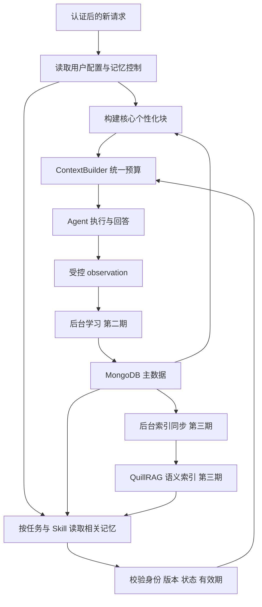

# Agent 个性化配置与长期记忆实施计划

本计划面向 farm-manager 主系统与独立部署的 QuillRAG，建设用户可主动配置、可查看纠正、可逐步学习的个性化助手。用户首次使用时即可设置称呼和回复方式，后续通过明确表达与使用习惯积累跨会话记忆。

采用“MongoDB 保存结构化主数据、QuillRAG 提供可重建语义索引”的架构。第一期交付个性化设置与明确记忆闭环，第二期增加自动习惯学习，第三期接入语义召回。各期独立验收，第一期不依赖向量服务。

## 2026-10-23 实施结果与部署

已在 `codex/agent-personalization-memory` 实现完整功能链：Web 和 Flutter 配置入口、对话明确记忆工具、临时模式、候选学习、独立 QuillRAG 索引、版本回查与删除屏障。下文保留原始方案，**本节说明最终实现与取舍，优先于原始分期设想**。本地实现完成不代表生产已部署。

### 最终数据布局

- `agentUserPreferences`：`_id=JWT issuer:user_id`，包含 snake_case 的 settings、field_sources、memories、revision、memory_generation、learning_generation、index_pending。
- 保留单用户聚合文档，通过 revision CAS 原子更新设置、记录和删除代次；无需 Mongo 多文档事务。最多 200 条非删除/非过期记录，删除屏障不占有效容量。删除正文和条件，保留标识，避免重试复活。历史屏障持续保留，长期高频写入场景应监测文档大小并迁移独立记录集合，不能无界扩容。
- `agentMemoryLearningTasks`：按 owner + turn_id 幂等创建任务，记录本轮完整用户输入（超过 12000 字符直接跳过）、控制代次、租约、重试次数；成功、失效或最终失败后移除任务原文。来源引用为 `turn:<turn_id>`，可关联既有会话记录；尚无独立的证据全文查看接口。
- `agentMemoryIndexManifest`：记录每个 owner + memory_id + revision 对应的不可变索引 ID，先登记再上传，旧版本异步删除。清单保留以修复并发旧上传；不在索引中存放未确认候选。

### 用户操作与运行链路

2026-10-23 补充：普通偏好陈述与显式持久化请求分开核验。助手不实的保存承诺不能反向制造用户授权；
语义核验分别输出本轮显式请求、普通偏好、成功声明和故障声明。纯偏好交流出现无证据承诺或沿用历史报错时，
Runtime 可改为只确认当前对话参考，不返回整轮失败，不阻断后续受控观察；存在其他业务调用或明确保存请求时不能走该降级。

模型误调用记忆写工具但核验确认为普通偏好时，返回 `memory_observation_only`、`persisted=false`，
不读取或修改持久化记忆；仅由正常完成后的学习任务及用户开关决定是否自动归类保存。显式请求仍需授权、证据、
临时模式及敏感信息校验。没有 `memory_revision` 的拒绝或参数错误不是记忆快照，必须保留原始 code/message，
不能被刷新逻辑改写成“快照失效”；带旧版本的真实记忆内容仍按原有删除屏障清理。
语义核验兼容供应商返回的完整 JSON 代码围栏，但仍拒绝混杂文本和字符串布尔值，不放宽授权字段校验。

Web「助手设置」和移动端「我的 → 个性化与记忆」连接同一套 `/api/v2/me/...` API。支持称呼、助手名称、风格、长度、格式、自定义指令、等待提示与执行过程显示；记忆支持新增、编辑、兼容启用旧版候选、按范围和分类查看、删除和清空。Web 支持过滤分页和适用条件编辑，移动端加载分页结果并支持选择个人/当前农场范围。

`manage_personal_memory` 统一处理明确保存、查询、更新、删除、清空和配置。写操作必须提供当前或近期用户原文证据与本轮操作意图；近期历史仅解释确认对象，最多六条且遵守会话重置。跨轮内容另用仅含用户原句的核对，助手提议不能制造用户事实；用户身份和版本由运行时注入。凭据赋值、常见令牌、身份号码有确定性拦截，抽取提示同时排除敏感、引用与临时内容；规则不等于通用敏感信息识别器。

自动学习默认开启；历史配置没有显式选择时按新默认读取，用户明确关闭仍保持关闭，读取本身不写数据库。普通会话成功结束后异步抽取稳定、非敏感的个人背景、兴趣偏好、工作习惯和表达偏好，按 profile/preference/work/response/general 分类。通过原文证据校验即自动 active，无需用户逐条审核。临时、引用、敏感或不确定内容跳过。旧 candidate 不批量转正，仅在新的稳定观察支持时更新；界面标为旧版候选，保留手动启用入口。

观察和归并独立：先从本轮用户原文判断长期价值，再优先选择同 key、同分类的最多 30 条可见记忆做语义对齐。同义 reinforce 累计证据，互补 merge 原地合并，明确纠正 contradict 更新冲突部分并保留其他细节，无关联 new 新增。模型必须返回每个候选唯一关联及完整合并文本，不完整结果交后台重试，不盲目写入。原始分类和目标身份由代码保护；显式设置不能被自动覆盖。手工记忆仅允许晚于其更新时间的明确纠正原地更新，普通补充或旧任务仍不能覆盖；更新后标为自动学习来源。

同一 Turn 不重复计证据，置信度初始 0.3、每个独立轮次增加 0.2、最高 0.9，仅表示证据积累，不再作为审批门槛或准确率。任务携带 observed_at 和控制代次，抽取前后的聚合版本不一致时重新归并；旧观察不得覆盖更新的事实。自动记忆直接 active 且不设置候选到期时间。删除和清空仍抹除正文并提高代次，阻止旧任务恢复；不是禁止用户以后重新明确提供新信息。无变化的观察不增加聚合版本。

明确记忆工具也使用语义审查确认本轮授权，已移除关键词正则作为操作授权条件。最终回答由独立语义审查区分“读取已有偏好”与“本轮保存成功”，没有真实持久化结果不能宣称已保存。调用与最终核验均有超时边界，故障不伪装成功；因此普通回复会增加一次小型语义核验请求，直接记忆写入会增加一次授权核验，跨轮写入另有内容依据核对。后台自学习不走显式写工具授权，也不弹用户确认。工具执行发出 started/finished 与 Trace，前端可核对实际保存结果。

本轮参考 `ocean/mnemo-mcp` 的 auto_observe、反馈升降权和 Dream 语义归并机制，保留当前系统的用户/农场隔离、CAS 与删除屏障；没有接入其单用户 SQLite，也没有把检索次数当成正确性反馈。本次未迁移独立 helpful/unhelpful 接口、全库定时 Dream、时间衰减评分或自动删除历史记忆；现有遗忘仍是用户删除，历史候选兼容原有到期时间。

临时模式使用 `temporary:` 会话命名空间，隔离普通会话上下文，不读个性化、不开放记忆工具、不生成学习任务；仍保存普通聊天历史，客户端明确提示。已排队学习任务在消费前和提交前检查控制代次。主 Agent 每次模型调用前刷新个性化并抹除失效的记忆工具快照。删除不会改写用户自己的历史消息或已展示的回答。

核心设置直接读取 Mongo，记忆按相关性、来源和时间选择最多 5 条，投影预算默认 3000 字符，携带真实 memory_id 和 revision，禁止用顺序编号替代记录 ID。来源标记区分手工与产品默认值；适用条件随记录交给模型判断，未实现复杂条件表达式引擎。记忆以 user 级数据注入，不改变业务权限及确认流程。

工具纠正以当前身份读取的目标记录为基线，只按本轮用户原文修改变化部分，保留未涉及的事实；局部否定不能授权删除整条复合记忆。更新和删除在审查后核对目标版本。普通观察结果明确不再重试，纯偏好直接正常完成并进入后台学习；混合业务继续执行。不可重试的记忆错误立即收尾，可修复错误最多允许一次修复；不会反复改参数直到触发 doom loop。详见 `docs/design/self-learning-memory.md`。

### 部署配置

沿用 Agent 现有 Mongo 连接和模型配置，不增加基础设施依赖。新的学习/索引消费者由 Agent lifespan 启停，使用独立循环，RAG 慢请求不阻塞学习。Mongo 为权威存储，RAG 无配置或故障时仍可使用结构化记忆和核心设置。

| 环境变量 | 默认值 | 作用 |
|---|---|---|
| `MEMORY_RAG_URL` | 空 | 配置为 `https://rag.lllcnm.cn` 启用语义索引 |
| `MEMORY_RAG_API_KEY` | 空 | 由服务器密钥管理注入，仅发送 X-API-Key |
| `MEMORY_RAG_COLLECTION` | `agent_user_memory` | 必须使用专用集合，禁止指向 `ticket_knowledge` |
| `MEMORY_CONTEXT_TIMEOUT` | 1.5 秒 | 整个个性化读取预算，超时降级 |
| `MEMORY_ASSESSMENT_TIMEOUT` | 15 秒 | 明确操作授权与最终答复语义核验预算 |
| `MEMORY_RETRIEVE_TIMEOUT` | 0.8 秒 | 双作用域检索总预算 |
| `MEMORY_INDEX_TIMEOUT` | 30 秒 | 单次索引 HTTP 超时 |
| `MEMORY_POLL_SECONDS` | 5 秒 | 后台轮询间隔 |
| `MEMORY_LEASE_SECONDS` | 120 秒 | 任务/索引领取租约 |
| `MEMORY_ATTEMPTS` | 3 | 学习最大尝试次数 |
| `MEMORY_CONTEXT_CHARS` / `MEMORY_EXTRACTION_CHARS` | 3000 / 12000 | 投影/抽取输入上限 |

索引适配器通过 QuillRAG 幂等 `POST /collections` 创建专用集合，分批上传，每批最多 3 条；召回按可信 owner、scope、farm_uid 强制过滤，结果 ID 再与 Mongo 有效版本比对，不使用 RAG 返回的文本作为权威记忆。索引失败保留待处理状态，租约到期后重试；删除索引有延迟，但已删除版本不会再进入新的个性化投影。

前端默认真实接口；不要将 `VITE_PERSONALIZATION_API_ENABLED` 设为 `false`，该值仅供显式演示。移动端复用已认证的 Agent ApiClient。

### 验证与发布边界

回归覆盖 API 权限/身份隔离、版本冲突、记忆生命周期、独立证据计数、学习开关和清空屏障、临时模式、RAG 失败降级、索引创建及旧版本删除、Web 与 Flutter 配置保存及错误保留。HTTP 和 Mongo 以测试替身隔离，未向生产用户数据写入测试记录。

2026-10-23 已补做真实 Chrome + 本地运行 Agent + 实际 Mongo 的配置保存、刷新持久化、记忆新增/编辑、开关和临时入口验收，并修复记忆修改后开关使用旧版本的 409 问题。首次 404 源于旧 Agent 进程未重启；`agent/bootstrap/app.py` 默认 `reload=False`，新增路由后必须重启服务并核对 OpenAPI。

本地真实模型已验证无触发词的稳定习惯、表达偏好、临时要求排除、引用排除、同义归并和相反反馈识别。运行中后台队列与真实页面的后续结果记录在 OpenSpec tasks。生产启用前仍需在部署环境验证 QuillRAG 端到端、容量、任务失败和延迟。本次没有修改服务器配置或发布生产版本。

### 新模块边界

`personalization.py` 定义设置/记忆契约与投影；`tools.py` 由 Runtime 调用，校验对话写入证据；`learning.py` 由 Worker 投递、lifespan 消费，隔离异步学习副作用；`personalization_store.py` 由 API/Memory 调用，负责 Mongo CAS；`memory_index.py` 由记忆读取和后台消费者调用，隔离 QuillRAG 协议。这些职责无法合理放进已有短期会话存储或庞大的 Runtime 文件。Flutter 新页面由资料页导航调用，负责同一服务端配置的编辑和记忆管理。

本轮新增 `tests/conftest.py` 只隔离 Runtime 单元测试中的外部语义模型请求，各用例可覆盖其结果；真实模型与 Mongo 队列另行实测。生产没有新增包装模块。学习的原子更新函数保留同一处处理证据、冲突和晋升，保证一次 CAS 提交全部状态，避免把共同可变文档拆散成无边界的小函数。

## 1 目标与范围

### 1.1 用户可感知的结果

- 在设置页选择回复风格、详细程度、展示方式，配置称呼和自定义指令。
- 在对话中说“记住，以后先给结论”，新会话中仍然生效。
- 查看“助手记住了我什么”，了解来源并修改、删除。
- 在启用自动学习后，从多次实际交互中逐步形成有证据的偏好。
- 临时改变本次回答方式时，不意外修改长期设置。
- RAG 服务不可用时，仍保留核心个性化体验。

### 1.2 首期边界

首期支持个人全局偏好与个人在特定农场中的偏好。农场共享规则保留扩展位置，但不开放自动写入；后续接入时必须使用管理权限和明确发布流程。

实时库存、工资、工单状态等继续从业务系统查询。短期任务状态、会话摘要、公共知识库不迁入长期偏好存储。首期不建设知识图谱，不训练个性化模型，不允许模型自动修改系统提示词或业务权限。

本计划是后续实施依据，不代表接口、集合或 UI 已上线。生产部署版本、MongoDB 拓扑、统一用户身份边界在第一期开始时核对。

## 2 现有基础与接入位置

| 位置 | 本地现有能力 | 计划改动 |
|---|---|---|
| `agent/domains/harness/memory/long_term.py` | `observe()` 保存受控 observation；`search()` 返回空列表 | 补齐长期记录写入、读取、更新、删除和任务检索 |
| `agent/domains/harness/memory/service.py` | Memory Service 统一入口 | 对 Runtime 屏蔽持久化与 QuillRAG 协议 |
| `agent/domains/harness/memory/policy.py` | 按显式请求或 Skill 依赖开启长期记忆 | 分离核心个性化加载与相关记忆召回策略 |
| `agent/domains/harness/context/builder.py` | 已有 `memory_hits`、版本及预算机制 | 增加核心个性化块，记录有效配置来源和裁剪结果 |
| `agent/application/worker.py` | 已有 observation 持久化调用 | 补充来源消息引用、学习开关与幂等处理 |
| `agent/platforms/persistence/mongo/chat_store.py` | 会话及 observation 持久化 | 复用连接和身份约束；偏好记录使用独立集合 |
| QuillRAG | 文档入库、metadata、过滤检索、重排、Qdrant 与 SQLite | 第三期增加受控记忆索引适配与一致性校验 |

现有 observation 只截取用户输入和助手回答的前 500 字符。新抽取流程必须关联已持久化的消息 ID，并按需读取完整证据，不能把截断摘要当作唯一依据。

本计划扩展既有 [Context Session Memory 设计](./2026-08-20-agent-context-session-memory-system-design.md)，保留 Conversation、Session View、ContextBundle 和 Memory Service 的职责边界。只有本计划中的功能实现并验收后，才更新既有设计的能力状态。

## 3 产品设计

### 3.1 个性化设置

| 设置 | 初始选项或形式 | 执行位置 |
|---|---|---|
| 用户称呼 | 可编辑文本，可留空 | 模型上下文 |
| 助手名称 | 产品默认名称，可修改 | 模型上下文和界面 |
| 回复风格 | 默认、亲和易懂、专业严谨、高效务实 | 服务端模板映射 |
| 回答详细程度 | 简洁、适中、详细 | 模型上下文 |
| 默认展示方式 | 自动、优先表格、优先列表 | 模型上下文，按内容适用性处理 |
| 自定义指令 | 有长度限制的文本 | 用户级指令块 |
| 加载欢迎语 | 开关 | 前端展示 |
| 执行过程展示 | 精简、详细 | 前端展示，不控制实际权限 |

风格与详细程度相互独立，允许“专业严谨且简洁”。预设风格由服务端版本化模板维护，用户保存枚举值；不让客户端提交系统级提示词。

设置保存后从下一轮生效，同一轮内保持快照稳定。保存失败时界面展示失败原因并保留编辑内容，不把本地乐观更新当作保存成功。

第一期先落在现有管理 Web 的助手设置入口；移动端复用同一 API，作为独立接入任务。客户端不存在入口时，以现有导航结构确定位置，不为记忆另建独立应用。

### 3.2 记忆管理

| 功能 | 行为 |
|---|---|
| 自动学习偏好 | 控制是否从新交互生成或提升候选记忆，默认关闭，由用户开启 |
| 使用已保存记忆 | 控制是否注入记忆记录；不关闭用户手工填写的个性化设置 |
| 记忆列表 | 展示内容、范围、明确保存或自动学习、状态、更新时间和来源摘要 |
| 编辑与确认 | 用户修改后转为明确来源，校验版本并保留必要变更记录 |
| 删除单条 | 立即停止后续上下文读取，同时安排索引和缓存清理 |
| 清空记忆 | 先停用全部记录并提高用户记忆代次，再清理派生数据 |
| 临时对话 | 不读取个性化与记忆，不产生学习事件或持久化偏好写入 |

临时对话仍使用系统规则和当前请求提供的信息。“不使用记忆”不等同于“聊天记录不保存”；会话记录保留按独立的历史策略执行，并在产品中说明。临时模式下若用户要求长期记住，提示切换普通会话，不暗中持久化。

自动学习开关关闭不影响用户主动执行“记住”。开关、编辑、删除功能应在学习能力上线前具备，避免用户无法纠正误记。

### 3.3 设置与记忆的一致呈现

预定义配置键只有一份权威值。例如 `response.detail_level` 同时支持设置页修改和对话中的“以后详细一点”，两条入口更新同一份配置；记忆列表可以显示它的来源投影，但不另存一个可覆盖设置的有效值。

自动推断的同类偏好保存在记忆集合，只有用户尚未显式配置该键时才允许参与决策。用户把设置“恢复默认”时要明确记录这一选择，不能因字段为空又被历史推断覆盖；“允许自动适应”作为独立语义。

## 4 存储与数据模型

### 4.1 存储分工

| 组件 | 负责内容 | 一致性约束 |
|---|---|---|
| MongoDB | 用户设置、长期记录、证据、任务状态、删除屏障 | 主数据决定最终可见性 |
| QuillRAG 与 Qdrant | 经过筛选的记忆文本及检索元数据 | 可重建；不能单独决定记忆是否有效 |
| QuillRAG SQLite | 记忆索引文档的元数据 | 属于索引侧投影，不接管用户记忆主数据 |
| Redis | 可选的短期配置缓存 | 第一期优先直读 Mongo；引入后按版本失效 |
| 现有业务库 | 库存、成本、工单、权限等业务事实 | 记忆不得覆盖业务查询结果 |

MongoDB 的 schema 校验、索引和更新约束提供结构化存储。向量是检索手段，不承担偏好冲突处理和生命周期管理。

### 4.2 用户配置

建议集合 `agentUserPreferences`，字段采用现有 Mongo 命名规范。按认证体系确定的用户命名空间建立唯一索引。

| 字段组 | 内容 |
|---|---|
| 身份 | `userId`；若用户 ID 不是全局唯一，必须增加认证租户标识 |
| 配置 | `nickname`、`assistantName`、`replyStyle`、`detailLevel`、`displayFormat`、`customInstructions` |
| 界面 | `loadingGreetingEnabled`、`executionDetailLevel` |
| 记忆控制 | `autoLearnEnabled`、`useSavedMemories`、`learningGeneration`、`memoryGeneration` |
| 元数据 | `revision`、创建和更新时间；每个可推断配置键的来源、更新时间、是否显式设置 |

### 4.3 长期记忆

建议集合 `agentMemoryRecords`，一条记录表达一个可独立更新的偏好、习惯或经历。

| 字段 | 用途 |
|---|---|
| `memoryId`、`schemaVersion` | 稳定身份与数据格式版本 |
| `userId`、认证租户标识 | 个人归属，由可信服务端填入 |
| `scope`、`farmId` | 首期为 `user` 或 `user_farm`，个人全局记录不携带农场值 |
| `kind` | `preference`、`habit`、`episode` |
| `key`、`value`、`text` | 归一化偏好键、类型化值、可读描述 |
| `conditions` | 适用任务或领域，例如“成本报表” |
| `sourceType` | `explicit` 或 `inferred` |
| `sourceMessageIds`、`sourceObservationIds` | 可回溯证据，不复制完整聊天记录 |
| `evidenceCount`、`confidence` | 独立证据数量与辅助判断；模型分数不能独自决定提升 |
| `status` | `candidate`、`active`、`superseded`、`expired`、`deleted` |
| `revision`、`memoryGeneration` | 并发控制和删除后的任务失效判断 |
| `createdAt`、`updatedAt`、`expiresAt` | 时间生命周期，存储统一 UTC，按用户时区展示 |
| `indexedRevision`、`indexStatus` | 索引进度；第三期启用 |

同一身份、作用域、归一化键和条件只允许一条有效单值偏好。多值偏好按集合语义更新；经历使用独立 ID，不因文本相似直接合并。

常用索引覆盖“身份 + scope + farmId + status + key”和按更新时间分页；有效单值偏好使用有条件的唯一约束。字段白名单、枚举、长度、过期参数集中定义。

### 4.4 原子写入与后台任务

更新使用 `revision` 做比较并交换，冲突返回明确错误并重新读取，不能以后台任务完成顺序覆盖用户意图。事件时间由服务端来源记录确定。

主数据变更必须同时留下可恢复的待处理标记。若 Mongo 拓扑支持事务，可使用事务性任务记录；否则把待索引版本写在同一文档中，由工作任务扫描并幂等消费，避免主数据成功但索引任务永久丢失。

第一期不需要新增索引队列；第二期复用现有 observation 集合作为持久候选来源，增加领取租约、重试和失败状态；第三期再启用索引任务。

## 5 记忆写入与冲突处理

### 5.1 明确保存

1. 从当前请求识别“记住”“以后都”等持久意图，以及限定的作用域。
2. 生成受 schema 约束的写入候选，区分预定义配置键和开放记忆记录。
3. 服务端校验身份、内容、范围、来源和幂等键。
4. 查询现有有效值，以原子更新保存新版本。
5. 持久化成功后才向用户确认“已记住”；失败返回包含 `code` 的结果。
6. 第三期在后台同步对应向量索引。

模型不能自行提供生效的 `userId`、权限、版本或数据库查询条件。一次消息包含多项变更时，必须返回逐项结果；需要整体一致的关联设置使用同一文档原子更新。

### 5.2 自动学习

1. 已完成的 Turn 保存来源消息，再创建 observation；临时对话和未开启学习的请求不创建学习任务。
2. 后台抽取稳定偏好、适用条件和证据；引用文档、工具返回文本、助手自己的陈述不作为用户偏好的独立证据。
3. 与同范围既有记录比较，输出新增、补证、更新候选、冲突或无操作。
4. 低风险展示偏好达到证据门槛后启用；业务操作习惯保留为建议或待用户确认。
5. 提交前重新检查学习开关、学习代次、记忆代次和目标记录版本。

首轮评估可以采用“至少 3 个不同 Turn，覆盖至少 2 个 Conversation”的低风险候选门槛；这是待评估参数，不是已经验证的可靠性标准。重复投递、助手复述和记忆再次注入都不得增加证据计数。

关闭自动学习时增加 `learningGeneration`，使排队任务失效；重新开启后仅处理新来源，历史回填必须单独授权。

### 5.3 生效优先级

系统规则、业务权限和必要确认流程始终执行。个性化候选先判断适用条件，再按下表确定同一事项的有效值。

| 优先级 | 来源 |
|---|---|
| 1 | 当前请求的明确要求，仅对当前任务生效 |
| 2 | 用户主动设置或明确保存的偏好 |
| 3 | 有证据的自动推断习惯 |
| 4 | 产品默认值 |

同级来源中，适用场景更具体的规则优先；同范围明确更新按来源时间及版本处理。无法确定新信息是更新还是不同场景时保留候选，不静默替换。

“这次详细解释”不写长期配置；“以后都详细解释”更新配置并同步设置页。“喜欢先预览排班”可以影响交互顺序，不能成为跳过业务确认的授权。

## 6 读取与上下文注入

核心个性化包含少量称呼、表达设置和适用的明确指令，每轮直接读取。相关记忆按当前任务、领域和 Skill 依赖读取；第一期使用字段过滤，第三期追加语义候选。

上下文建议划分为静态系统规则、用户个性化配置、相关记忆数据、会话工作记忆、当前任务。配置和记忆均保留其用户来源；不得把不可信记忆内容提升为系统级指令。

核心配置读取在 ContextBuilder 之前完成；若 Skill Router 需要任务习惯，只传递必要且已授权的相关字段，不把完整用户画像交给 Router。

初始预算目标为核心个性化 300 tokens、相关记忆 500 tokens、相关条数最多 5 条，均集中配置并经评估调整。自定义指令设置保存长度上限，超预算时按稳定优先级裁剪并记录原因，不能暗中改写原始配置。

同一 Turn 默认使用稳定快照。用户删除、关闭使用或权限撤销时，下一次模型调用前校验控制版本并丢弃失效块；已经发出的模型请求无法撤回，产品说明删除从后续请求生效。

## 7 QuillRAG 接入

生产地址由现有 `rag_service_url` 管理。当前公共知识集合 `ticket_knowledge` 保持其业务用途，用户记忆使用独立配置 `rag_service_memory_collection`，建议值 `agent_user_memory`。

每条有效记忆映射到单独的短文档，携带不暴露业务原文的稳定 `doc_id` 和 `memoryId`、`revision`、可信身份范围等 metadata。显式指定 ID，不能用内容哈希作为跨用户共享身份。

复用现有 `/ingest`、`/retrieve`、文档删除能力；适配器确保一条记忆的边界不会被文档分块或去重逻辑破坏。若现有更新契约无法保证版本替换，再为 QuillRAG 增加受控的记录索引接口，不预先扩建通用记忆中台。

接入前必须完成：

- 服务凭证只在服务端使用；密钥通过环境或密钥管理注入，不写入计划、前端或日志。
- 个人记忆查询必须携带可信身份范围；客户端和模型不能决定 collection 或移除隔离条件。
- 全局个人范围与当前农场个人范围分别受控查询后合并，不能通过遗漏 `farmId` 意外放宽农场记忆范围。
- 向量、稀疏、混合、降级路径使用一致过滤；非法过滤结构必须拒绝，不能退化成无过滤搜索。
- 向量结果先回查 Mongo 主数据，再参与模型上下文或需要明文的重排；以主数据当前文本为准。
- 索引 `revision` 过旧、记录删除、过期或身份不匹配时丢弃，不直接使用向量 payload。
- 用户身份隔离是授权要求，单一 `X-API-Key` 只证明服务调用者身份，不能替代用户范围检查。

本地 QuillRAG 的文档可见性检查在元数据异常或空清单时存在兼容返回候选的路径。该行为不能作为记忆删除保证；主系统无法验证权威记忆状态时跳过记忆。

语义召回初始总耗时预算建议为 800 毫秒，包含网络及重试；默认不在前台重试，超时回退到结构化结果。该值须用生产网络与负载压测调整，不复用文件入库的 120 秒超时。

## 8 接口与错误契约

以下为主系统拟新增的 API，相对路径须在实施时与现有路由前缀核对；不表示现有端点。

| 接口 | 用途 | 主要约束 |
|---|---|---|
| `GET /api/v2/me/personalization` | 读取配置与控制开关 | 返回当前版本及字段来源 |
| `PATCH /api/v2/me/personalization` | 修改设置或记忆控制 | 要求预期版本；字段白名单 |
| `GET /api/v2/me/memories` | 分页查看记忆 | 受控 scope、状态和农场筛选 |
| `POST /api/v2/me/memories` | 主动保存明确记忆 | 幂等键；归一化键校验 |
| `PATCH /api/v2/me/memories/{memory_id}` | 修改或确认记忆 | 身份校验与版本检查 |
| `DELETE /api/v2/me/memories/{memory_id}` | 删除单条 | 幂等；主数据立即失效 |
| `POST /api/v2/me/memories/clear` | 清空个人记忆 | 明确操作范围并递增记忆代次 |

记忆清空不重置手工个性化配置，界面必须说明；恢复个性化默认值通过独立设置操作完成。场景记忆查询不接受任意其他用户 ID。

Agent 记忆工具复用同一个应用服务，不通过自调用 HTTP 复制规则。工具提供受控的保存、检索和删除能力，服务端注入身份；前台检索也可由 Context 生命周期主动触发。

错误包含 `code`、可读信息和必要上下文，例如 `memory_version_conflict`、`memory_scope_forbidden`、`memory_storage_unavailable`、`memory_disabled_for_temporary_session`。上下文允许请求 ID、记录 ID、预期版本，不回显密钥、完整偏好或其他用户内容。

## 9 删除与数据保留

删除先使主数据不可读，再异步清除索引和缓存。不能等待 Qdrant 成功才向后续请求隐藏记忆，也不能在主数据写入失败时声称已删除。

单条删除保留最小删除屏障，阻止已处理来源和在途任务重新生成同一条记忆。清空时提高 `memoryGeneration`，旧代次任务全部失效。用户之后重新明确保存属于新意图，可以生成新记录；不因历史屏障永久禁止用户保存。

删除屏障只保留必要的不可逆指纹或来源标识，不保留被删除的正文。其保留周期必须覆盖任务重试与回填窗口；删除审计、备份保留和账号注销流程在上线前与现有策略对齐。

候选和推断记忆支持到期复核；明确配置持续有效直到用户修改。密钥、密码、令牌不进入记忆；敏感内容不做自动推断。原始消息删除后，关联记忆的证据处理与删除联动要有明确策略，不能默认从备份重新抽取。

## 10 实施任务与阶段门禁

### 10.1 第一期 个性化与明确记忆

依赖：确认生产主系统版本、Mongo 可用性、统一用户身份和目标客户端入口。

- [ ] 核对已有 Context 与 Session Memory 未完成任务，确认本功能依赖的消息持久化、身份隔离和上下文预算路径。
- [ ] 固化预定义配置键、来源优先级、scope、长度与枚举，补充 API 契约。
- [ ] 建立配置和记忆集合、唯一索引、版本更新、删除屏障与迁移脚本。
- [ ] 实现设置读取与更新、明确记忆保存和管理 API，接入现有认证。
- [ ] 实现对话中的明确保存、修改、删除意图；预定义偏好与设置页共用写入。
- [ ] 扩展 Memory Service 和 ContextBuilder，注入核心个性化与字段匹配结果。
- [ ] 实现 Web 个性化页面、记忆列表、错误和空状态、使用开关及临时对话入口。
- [ ] 自动学习入口显示未开放或保持关闭，不提供无效开关。
- [ ] 补齐单元、真实存储集成与关键 UI 流程验证，运行项目适用的 lint、架构和复杂度检查。
- [ ] 小范围启用并记录读取延迟、失败降级、冲突与实际生效情况。

完成标准：跨会话和重启保持配置；设置页与对话修改一致；删除后不再使用；RAG 断开仍可个性化；个人与农场范围隔离通过。

### 10.2 第二期 自动习惯学习

依赖：第一期管理与纠正入口可用，来源消息可可靠关联。

- [ ] 扩展 observation 的来源引用和处理状态，实现租约、幂等、重试上限及失败诊断。
- [ ] 建立 schema 约束的抽取、冲突判断和证据合并流程。
- [ ] 实现候选提升、适用条件、过期、用户确认和拒绝机制。
- [ ] 接入学习开关和代次屏障，防止关闭或清空后在途任务重新写入。
- [ ] 建立带标注的多轮评估样本，先进行只生成候选的影子运行。
- [ ] 经误记与冲突评估后，仅开放低风险展示偏好的自动提升。
- [ ] 移动端复用 API 接入配置与记忆管理；若另行排期，明确当前支持端。

完成标准：不把临时请求变成长期偏好；不从助手输出自我强化；可解释每条自动记忆的证据；旧任务不能覆盖新设置；关闭学习后停止新增。

### 10.3 第三期 语义召回

依赖：前两期主数据与删除机制稳定；评估确认字段过滤不足以覆盖相关记忆需求。

- [ ] 核对 QuillRAG 部署版本与入库、更新、删除、过滤协议。
- [ ] 建立独立 collection 与 payload 索引，配置可信身份范围。
- [ ] 实现持久索引任务、版本同步、重试、删除清理和可重建流程。
- [ ] 增加语义检索适配器，完成主数据回查、去重、预算与超时降级。
- [ ] 验证 dense、sparse、hybrid 和 fallback 均保持隔离。
- [ ] 比较结构化召回与混合召回在相关性、回答质量、延迟和费用上的差异。
- [ ] 按用户白名单灰度，保持独立关闭语义召回的能力。

完成标准：过期索引不进入模型；服务故障不影响结构化配置；新增召回确实改善长尾记忆使用，且符合耗时预算。

## 11 验证矩阵

| 场景 | 预期 |
|---|---|
| 设置简洁，新开会话 | 核心偏好注入，回答遵循简洁要求 |
| 本次要求详细 | 本轮详细，长期配置不变 |
| 对话要求以后详细 | 写入成功后确认，设置页展示详细 |
| 自动推断与手工设置相反 | 手工设置优先，推断不覆盖 |
| 相同任务重复投递 | 不重复创建，不增加独立证据数 |
| 两个会话并发更新同一偏好 | 版本冲突可检测，旧任务不覆盖新值 |
| 一段长消息末尾包含偏好 | 使用完整来源证据，不受 500 字符截断影响 |
| 用户 A 与 B 使用相同文本 | 不因哈希或索引去重串记忆 |
| 同一用户切换农场 | 全局偏好保留，农场偏好按范围切换 |
| 非法或缺失的检索范围 | 拒绝查询或跳过召回，不退化为全库搜索 |
| 删除后向量还未清理 | 主数据回查丢弃，不使用旧文本 |
| 清空时有抽取任务在途 | 代次不匹配，提交失败且不复活 |
| 关闭学习但保留读取 | 使用已有记忆，不产生新学习记录 |
| 关闭读取但保留手工设置 | 不注入记忆，手工设置仍生效 |
| 临时对话 | 不读取个性化，不学习，不执行长期保存 |
| RAG 超时或 5xx | 在总预算内回退结构化结果 |
| Mongo 不可用 | 使用产品默认及当前请求，不宣称保存成功，不使用未验证向量结果 |
| 恶意文档要求记住或越权 | 不作为用户偏好证据，不改变权限 |
| 多轮 Context 超预算 | 按策略裁剪并可观测，不破坏必需任务信息 |

确定性契约使用单元与集成测试；自然语言抽取和个性化效果使用标注样本评估，并人工审查关键样本。上线不以“接口返回成功”代替实际回答效果验收。

## 12 可观测性与上线回退

Trace 记录配置版本、记忆代次、候选与采用数量、来源类别、裁剪原因、读取与抽取耗时、检索降级和索引滞后。默认不记录完整偏好正文或原始敏感消息。

关注指标包括偏好遵循率、误记率、用户纠正率、相关记忆采用率、已删除记忆误用次数、跨范围泄漏次数、读取 P95 延迟和每次抽取费用。删除误用、越权与串用户属于上线阻断问题；其余质量门槛由第一期建立的基线和第二期评估结果确定。

服务端功能开关分开控制个性化加载、长期记忆读取、自动学习和语义召回。回退顺序为先关闭语义召回，再关闭自动学习；必要时关闭记忆读取，仍保留手工设置和用户管理入口。关闭功能不删除数据，也不自动恢复已删记录。

上线前确认消息重放、用户注销、农场退出、备份恢复对记忆范围及删除屏障的影响，并完成旧客户端兼容检查。新增配置与接口在各期实现时同步到对应架构和 API 文档。

## 13 文件与模块边界

本计划集中保存在现有 `docs/spec/`，供产品、后端、前端和测试共同使用。作为既有 Memory 总设计的后续交付计划独立成文，避免把拟新增的产品配置与三期任务误写为已经完成的能力。

实现优先扩展现有 Memory、Context 和 Mongo 模块，不预先创建碎片文件。若引入独立的 Mongo 记忆适配器，其调用方为 Memory Service，边界为长期记录与索引约束，避免继续混入会话消息存储；QuillRAG HTTP 适配器隔离外部协议和故障，不能把网络调用散落到 ContextBuilder。

各期开发使用 `codex/*` 分支，按项目要求补测试、检查并提交 PR。新增文件或抽象在 PR 中说明调用方、职责边界和不能留在现有模块的理由。

## 14 参考

- [Context Session Memory 设计](./2026-08-20-agent-context-session-memory-system-design.md)
- [Context 与 Prompt Cache 架构](./2026-08-10-context-prompt-cache-architecture.md)
- [现有 Memory 长期入口](../../agent/domains/harness/memory/long_term.py)
- [现有 Memory 注入策略](../../agent/domains/harness/memory/policy.py)
- [现有 ContextBuilder](../../agent/domains/harness/context/builder.py)
- [QuillRAG 项目说明](../../../../QuillRag/README.md)
- [LangGraph 长期记忆概念](https://docs.langchain.com/oss/python/concepts/memory)
